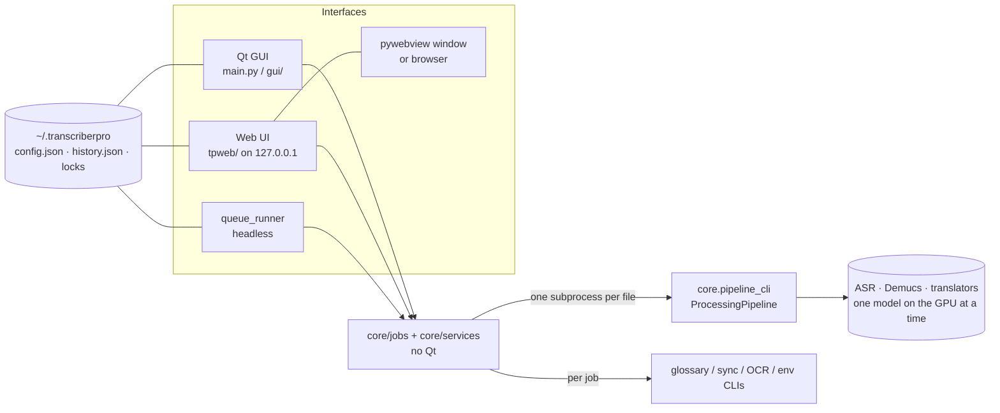
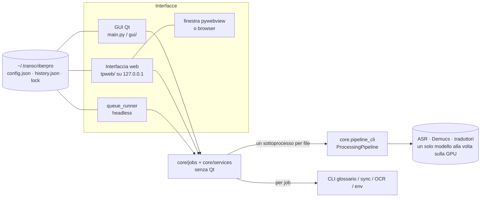

# Transcriber Pro


AI-powered application for automatic subtitle transcription, translation, and bitmap OCR from video files, with two interfaces on the same engine: a local web UI (`tpweb/`, the default) and the PyQt6 desktop GUI (being phased out).

---

> 🇮🇹 **[Versione italiana](#versione-italiana)** più in basso.

---

## What It Does

Transcriber Pro takes any video file and produces clean `.srt` subtitle files through two complementary pipelines:

**Audio → SRT pipeline**: extracts or transcribes audio with Faster-Whisper, then translates into Italian (or other languages) using local AI models or cloud APIs. Output is optionally uploaded to OpenSubtitles automatically.

**Bitmap OCR pipeline**: converts PGS (Blu-ray) and VOBSUB (DVD) image-based subtitle tracks directly to text SRT — entirely local, no cloud, verbatim faithful to the source bitmap. Non-Italian tracks are OCR'd and automatically translated to Italian.

**Two interfaces, one engine**: the desktop GUI (PyQt6, started with `python main.py`) and a web UI served from `127.0.0.1` only (started with `python main.py --ui web`, shown in its own native window or in the browser). Same queue, same engines, same configuration file; only one of them can drive the queue at a time.

**No subscription. No cloud dependency for local models. Runs entirely on your GPU.**

---

## Features

### Transcription & Translation
- **Multi-engine transcription with automatic language routing** — NVIDIA Canary-Qwen-2.5B (English only, best WER; optional, requires a dedicated `venv_canary` with NeMo 3.0.0), Qwen3-ASR-1.7B + Qwen3-ForcedAligner-0.6B (11 languages with word-level timestamps: zh, en, yue, fr, de, it, ja, ko, pt, ru, es; native language auto-detect), Faster-Whisper `large-v3` as guaranteed universal fallback (99 languages, VAD filter) — the pipeline never fails because of a new engine. Only one ASR engine in VRAM at a time. Engine selector in profile settings (`transcription_engine_mode`: auto / canary / qwen3 / faster-whisper) — **force Faster-Whisper here whenever you're not happy with Qwen3's output on a given file**
- **Language-specific Whisper models routed automatically** (`whisper_model_by_language`, `core/engine_router.py`) — French (`bofenghuang/whisper-large-v3-french`) and German (CTranslate2 conversion of `primeline/whisper-large-v3-german`) get a fine-tuned Whisper instead of Qwen3 in auto mode; Spanish is routed to plain `large-v3` after a 5-engine bench (Qwen3, Whisper, NVIDIA Canary-1B-v2, Cohere Transcribe, HiTZ) found Whisper matched Qwen3 on word recall with fewer hallucinations, more speed, and much better segmentation once combined with sentence-aware splitting. Falls back to the configured default model if the specialized one fails to load — a bad download never fails the file
- **Sentence-aware splitting extended to French, German and Spanish** (`core/whisper_sentence_split.py`, `whisper_split_sentence_langs`, default now `["en", "it", "fr", "de", "es"]`) — language-specific rules (French `¿`-less but spaced punctuation, German capitalized-noun continuations, ordinals, Spanish `¿¡` inverted punctuation, per-language abbreviation/conjunction lists) cut mid-sentence blocks from 33-50% down to 1-6% on real films in each language, measured against professional subtitles and confirmed not to regress English/Italian (bit-for-bit identical on regression checks)
- **Non-English sources translated with NLLB fine-tuned instead of TranslateGemma** — TranslateGemma's fine-tuning was English→Italian only and produced untranslated or hallucinated lines on other source languages; the pipeline now detects a non-English source and routes it to NLLB fine-tuned automatically, both in the main queue and in bitmap OCR translation
- **Forced-language retry correction (Qwen3-ASR and Faster-Whisper)** — both engines used to force the declared track language on every chunk/segment, so content actually spoken/sung in a *different* language (typically an English song or quote inside a non-English film) came back empty or garbled into the wrong language. Suspect chunks/segments (empty, too few words for the amount of voice present, or full of English words despite the forced language) are now retried with automatic language detection and kept only if the detected language is accepted (English by default — the only language validated against real hallucination risk on noise/applause). For Faster-Whisper this also examines the *gaps* between segments, since its own VAD often misses sung content entirely, splitting long gaps into sub-windows so a single retry call doesn't silently drop most of a song. Config: `qwen3_lang_retry_enabled`/`accept_langs`, `whisper_lang_retry_enabled`/`accept_langs` (both default on, English only)
- **Multiple translation engines**: NLLB-200-3.3B, NLLB fine-tuned, TranslateGemma-12B (LLM branch, optional LoRA adapter and custom local model path), Claude Sonnet API, OpenAI GPT-4o-mini
- **Professional dialogue style (Netflix)** — "- " dashes only when two speakers share the same SRT block (one line per speaker); speaker diarization extended to all engines (`dialogue_style_enabled`, default ON, requires a HuggingFace token); dashes preserved in translated SRTs across all 4 translation backends; `core/subtitle_formatter.py` handles CPL 42, anti-flash, fragment merging and dialogue grouping
- **Vocal separation** via Meta Demucs — isolates speech before transcription for better accuracy
- **Intelligent audio chunking** — splits at silence points for accurate timestamp alignment
- **Transcription quality is fixed at Maximum** — the Fast / Balanced / Quality / Maximum / Batch profiles are kept in the code but hidden and locked (`transcription_profile_locked`): Faster-Whisper always runs at maximum quality, while for Qwen3-ASR and Canary-Qwen the profile only changed the batch size, with identical text (measured). The engine selector stays
- **Force audio transcription** — bypass embedded subtitle extraction and always transcribe from audio
- **Gender correction v2 (audio-driven)** — fixes Italian grammatical gender in 1st/2nd person by detecting the speaker's gender **from the voice** (pyannote diarization + ECAPA classifier, 95% acc), then applying a deterministic morphological rewrite guarded by a validator — no LLM, no extra VRAM, hallucinations impossible by construction. Feminine accuracy on first-person lines: 19% → 87% (validated on 700+ auto-extracted test points). Addressee gender for 2nd person comes from dialogue turn-taking (91% acc) and TMDB-cast vocatives

### Subtitle Synchronization
- **Multi-file sync queue + timing-only alignment engine** (`core/timing_aligner.py`) — aligns an out-of-sync external subtitle file to the correct timestamps using only timing/order heuristics (no LLM semantic matching needed for the common case), tested at 100% of rows within 0.5 s; replaced the Qwen2.5-14B semantic matcher as the default path, cutting a typical episode from ~81 minutes to ~2 seconds. Can now process a whole batch of files back to back instead of one at a time

### Bitmap OCR (PGS / VOBSUB → SRT)
- **PGS (Blu-ray) and VOBSUB (DVD)** bitmap subtitle tracks converted to text SRT — verbatim, no AI hallucination
- **Parallel multi-core OCR** — Tesseract runs on multiple CPU cores simultaneously (measured ~11× on a full film, 767 PGS events: ~195 s single-core → ~15-20 s parallel)
- **Per-track language detection** — Tesseract model selected automatically from the track's language tag; supported: Italian, English, Spanish, French, German, Portuguese, Dutch (tessdata_best)
- **Automatic translation to Italian** — non-Italian tracks are OCR'd in their source language, saved as `<stem>.<lang>.srt`, then translated to Italian and saved as `<stem>.it.srt` (both files kept)
- **Configurable strategy** — *Targeted review* (OCR + human review UI showing uncertain lines side-by-side with the original bitmap image) or *Automatic* (no review, direct output)
- **Configurable parallel workers** — slider in Settings → Subtitle OCR; default auto = `min(CPU cores, 8)`
- **Write-back modes** — remux SRT as new track inside the MKV in-place, or save as sidecar `.srt` next to the video (VOBSUB always sidecar)

### Per-show Glossary (semi-automatic)
- **Tools → Per-show glossary** — finds terms a translation engine renders inconsistently across a show's episodes (e.g. a proper noun translated one way in one episode, left untranslated in another) and proposes a single fixed rendering, applied automatically to future translations of that show (`core/glossary.py`, matched by TMDB id)
- **Two independent cross-checking channels** — SimAlign+LaBSE word alignment and a local Qwen span-extraction pass (mechanically validated: a proposed span must be a literal substring of the actual Italian text, never trusted as a judge) — a term is only auto-flagged when both channels agree on the divergence and the dominant rendering
- **Per-show gate** — a show needs enough translated episodes/blocks before candidates are computed, avoiding false positives on thin data
- **Review UI** — per-term cards with the proposed rendering (editable), approve/reject, and a merge-not-overwrite save (rotated backup, never a destructive overwrite of an already-validated glossary)
- **Fully isolated subprocess** — runs in a dedicated `venv_glossary/` (SimAlign/sentence-transformers/torch conflict with the main venv's `transformers==4.57.6`); the GPU-side Qwen channel is delegated back to the main venv via a bridge subprocess so only one model is ever resident at a time

### Library Scanner Integration
- **Self-hosted media server integration** (Plex / Jellyfin) — scans the library, shows files without Italian subtitles
- **Format filter** — filter by All / PGS / VOBSUB to target bitmap-only files for OCR conversion
- **Bitmap badges** — PGS / VOB / MIX clickable badge on each row; click launches OCR for that file
- **Batch OCR** — "Convert all (OCR)" button converts all visible bitmap files automatically
- **Live progress in processing queue** — OCR jobs appear in the main processing queue with status dot, progress bar, and OCR·PGS/VOBSUB tag; do not interfere with the audio transcription queue
- **Automatic DB sync** — after each successful OCR the scanner database is notified (`notify-subtitle` endpoint) so the file exits the "no subtitles" list; a widget sync refreshes the view
- **ASS/SSA → SRT conversion** — server-side remux of text-based embedded subtitles (handled by Library Scanner container, not Transcriber Pro)
- **Italian audio detection** — filename tag detection (ITA, NUiTA, MULTI, etc.)
- **Real-time DB update** on subtitle creation

### Metadata & Upload
- **TMDB / OMDB metadata** — auto-fetches film synopsis for context-aware translation; robust title parsing
- **OpenSubtitles upload** — REST API integration with duplicate detection

### Interface & Infrastructure
- **IT / EN interface** — full bilingual UI; auto-detects system locale; language selector in General Settings
- **Unified Settings dialog** — sidebar + stacked content: General, Job options, Transcription, Translation, Adaptive Batch, OpenSubtitles, Subtitle OCR (7 tabs)
- **SVG icon system** — 38 vector icons, theme-aware
- **Real-time resource monitor** — GPU / CPU / RAM usage during processing
- **GPU memory management** — sequential model loading/unloading; Demucs, ASR engine, and translation model never run simultaneously; cuBLAS workspace cleanup; Demucs tensors kept on CPU (only the segment being processed moves to GPU) → constant ~0.6 GB VRAM peak regardless of file length
- **Freeze-free startup** — torch is never imported in the GUI process (environment check via external CLI); async I/O; splash in ~2 s, Translation tab from 3719 ms to 15 ms
- **Embedded subtitle extraction** — skips transcription when clean text subtitles already exist; bitmap-only streams trigger the OCR pipeline instead. Track choice is one ranking (Italian text > Italian bitmap > English text > English bitmap > other languages); the language of a track is decided by its *content* (wrong or missing tags are corrected from the extracted text / OCR text, never from the title alone); "forced" tracks are recognised by flag or title, except a flagged track that is clearly the full subtitle (many events per minute). In the pipeline the OCR output is always written as a `.it.srt` next to the video — the MKV is never modified
- **Immediate stop** — confirmation dialog; kills FFmpeg / Demucs / Whisper within seconds; cleans temp files automatically
- **Processing queue** — Queued / Active / Completed / Failed filters with live badges
- **Web UI (`tpweb/`)** — a second interface for the same program: processing queue (add files/folders, filters, drag-and-drop reordering, per-file exceptions, start/stop, shutdown when done), preview with TMDB poster, live log with the *Compact Log*, the *Pipeline in progress* card with per-step ETA, resource monitor, history, the 7 Settings tabs, the per-show Glossary and Subtitle Sync dialogs, and the Library Scanner (list, filters, import, ASS/SSA conversion, OCR with targeted review, Superpower). It runs a FastAPI server bound to `127.0.0.1` with a random token per start; no PyQt6 and no torch in the server process. See [Interfaces](#interfaces-qt-gui-and-web-ui) and [docs/WEBUI_USO.md](docs/WEBUI_USO.md)
- **Native window for the web UI (optional)** — with `pywebview` installed the page opens in its own window (WebView2 on Windows) with the real Windows file/folder dialogs and drag-and-drop from Explorer; closing the window while the queue is working asks for confirmation. Without it, or if the window does not open, the default browser is used
- **Headless queue** — `python -m core.queue_runner` runs a whole folder without any GUI (same per-file subprocess, `queue_status.json` state file, optional Windows notification)

---

## Hardware Requirements

| Component | Minimum | Recommended |
|-----------|---------|-------------|
| **GPU** | NVIDIA 6 GB VRAM | NVIDIA RTX 3060 12 GB |
| **RAM** | 12 GB | 16 GB+ |
| **Storage** | SSD (models + temp files) | NVMe SSD |
| **OS** | Windows 10/11 | Windows 11 |

> CPU-only mode is supported but ~10× slower. GPU is strongly recommended.

---

## Software Requirements

- **Python** 3.11
- **NVIDIA driver** 528+ (560+ recommended); the system CUDA Toolkit is **not** required: CUDA/cuDNN libraries ship inside the pip wheels
- **Visual C++ Redistributable 2015-2022 x64** (`MSVCP140.dll`; the installer checks it)
- **FFmpeg** 6.0+ (must be in PATH)
- **Tesseract OCR 5+** with `ita` and `eng` traineddata from [tessdata_best](https://github.com/tesseract-ocr/tessdata_best) (required for the OCR pipeline)
- **MKVToolNix** (`mkvextract`) — required for VOBSUB extraction only
- **Web UI (optional, already in `requirements.txt`):** `fastapi`, `uvicorn`, `httpx`. For the native window add `pywebview==6.2.1` (`requirements-web.txt`) and the Microsoft Edge **WebView2** runtime (present on Windows 11 and on up-to-date Windows 10); without them the web UI opens in the default browser
- **Git** (for cloning)

> The Qwen3 ASR engine is installed with the standard dependencies (`qwen-asr` pip package, already in `requirements.txt`). The NVIDIA Canary engine is **optional** and lives in a dedicated `venv_canary` virtual environment with NeMo 3.0.0 (its dependencies conflict with the app's pinned ones); if absent, the router simply falls back to Qwen3 / Faster-Whisper.

---

## Installation

### Quick install (Windows, recommended)

```bat
git clone https://github.com/chinasky71-byte/TranscriberPro.git
cd TranscriberPro
:: prerequisites report, changes nothing
install.bat -CheckOnly
:: also offers to install missing programs with winget (asks for each)
install.bat -InstallSystemDeps
:: everything: extra environments, local models, no questions
install.bat -All -Yes
```

`install.ps1` checks Python 3.11, the NVIDIA driver, FFmpeg, Tesseract (`ita` + `eng`), MKVToolNix and free disk space; creates `venv` and installs `requirements.txt`; optionally creates the secondary environments (`-WithNlp`, `-WithCanary`, `-WithGlossary`) and downloads the local models (`-WithModels`); finally runs `scripts_manutenzione\selfcheck_env.py`. It can be re-run safely and never copies or writes credentials.

### Manual install

```bat
py -3.11 -m venv venv
venv\Scripts\activate
pip install -r requirements.txt
python main.py
```

`requirements.txt` pins the exact tested versions. `torch` (`+cu126`) and `llama-cpp-python` (CUDA wheel) come from the two extra indexes declared at the top of the file, so a single `pip install -r` is enough.

| File | Environment | Needed for |
|------|-------------|------------|
| `requirements.txt` | `venv` | the app |
| `requirements-nlp.txt` | `venv_nlp` | Gender Correction v2 (spaCy `it_core_news_lg`, runs in a subprocess) |
| `requirements-canary.txt` | `venv_canary` | optional NVIDIA Canary engine (NeMo, English only) |
| `requirements-glossary.txt` | `venv_glossary` | per-show glossary builder (CPU torch) |
| `requirements-dev.txt` | `venv` | evaluation tools only (`sacrebleu`, `vastai`) |

Notes:
- `setuptools` is pinned to 70.3.0 on purpose: `ctranslate2` 4.6.0 imports `pkg_resources` on Windows, so do not upgrade it blindly.
- No CUDA Toolkit is required, only a recent NVIDIA driver: the CUDA and cuDNN libraries ship inside the pip wheels (torch, ctranslate2). `llama-cpp-python` reuses the CUDA 12 runtime DLLs shipped with torch: the app adds `torch\lib` to the PATH by itself. On a PC without a GPU use `install.bat -NoGpu`.
- Credentials are never part of the installer. Create them by hand: a HuggingFace token in the app settings (accept the `pyannote/speaker-diarization-3.1` conditions once on huggingface.co), a TMDB key in `tmdb_api.txt` (project root or `~/.transcriberpro/`), optionally `omdb_api.txt`, and Claude/OpenAI keys in the settings if you use cloud translation.
- Local models: `install.ps1 -WithModels` downloads Qwen2.5-14B (GGUF) and the fine-tuned NLLB from HuggingFace; the fine-tuned TranslateGemma is not on a hub and must be copied from the source machine. Whisper large-v3, Qwen3-ASR, Demucs and pyannote download on first use.

> For Tesseract OCR: install via [scoop](https://scoop.sh) (`scoop install tesseract`) or the Windows installer, then download `ita.traineddata` and `eng.traineddata` from [tessdata_best](https://github.com/tesseract-ocr/tessdata_best/tree/main) into the Tesseract `tessdata/` folder.

### Starting the app

| What | How |
|---|---|
| Default interface (web UI) | `Lancia Transcriptor.bat` (console) / `Lancia Transcriptor.vbs` (no console) / `python main.py` |
| Web UI | `Lancia Transcriptor Web.bat` / `Lancia Transcriptor Web.vbs` / `python main.py --ui web` (Linux: `./run_web.sh`) |
| Web UI chosen by the configuration | set `"ui": "web"` in `~/.transcriberpro/config.json`; `--ui qt` forces the GUI |
| Web UI options | `--shell auto\|on\|off` (native window), `--no-browser` (print the address only, no window) |
| Headless queue | `python -m core.queue_runner <files or folders> [--recursive] [--skip-existing] [--notify]` |

Optional native window: `pip install -r requirements-web.txt` inside the `venv`.

---

## Credentials Configuration

All credentials are entered through the application GUI — no config files to edit manually.

| Credential | Where to enter | How to obtain | Enables |
|---|---|---|---|
| **Claude API Key** | Settings → Translation → Claude | [console.anthropic.com](https://console.anthropic.com) | Claude Sonnet translation |
| **OpenAI API Key** | Settings → Translation → OpenAI | [platform.openai.com](https://platform.openai.com) | GPT-4o-mini translation |
| **HuggingFace Token** | Settings → Translation → HuggingFace | [huggingface.co/settings/tokens](https://huggingface.co/settings/tokens) | TranslateGemma-12B (gated model), pyannote diarization |
| **OpenSubtitles credentials** | Settings → OpenSubtitles | [opensubtitles.com](https://www.opensubtitles.com) | Subtitle upload |
| **TMDB API Key** | Settings → General → TMDB | [themoviedb.org/settings/api](https://www.themoviedb.org/settings/api) | Film metadata |
| **OMDB API Key** | Settings → General → OMDB | [omdbapi.com/apikey](http://www.omdbapi.com/apikey.aspx) | IMDb metadata fallback |
| **Library Scanner API Key** | Settings → Library Scanner | Your self-hosted server | Library integration |

All credentials are optional except for the translation model you choose to use. Local models (NLLB, TranslateGemma) and the OCR pipeline require no API keys.

---

## Basic Usage

### Audio transcription
1. Add video files — drag and drop or use the file picker
2. Pick the transcription engine under Settings → Transcription (Auto recommended; quality is fixed at maximum)
3. Choose a translation engine
4. Click **Start** — Demucs → chunking → Whisper → translation → SRT saved next to the video

### Bitmap OCR (PGS / VOBSUB)
1. Open the **Library Scanner** panel (requires a configured self-hosted media server)
2. Set the **Format** filter to PGS or VOBSUB
3. Click the badge on a single row, or **Convert all (OCR)** for the entire filtered list
4. The OCR pipeline runs automatically; progress appears in the main processing queue
5. Italian tracks → `.it.srt`; non-Italian tracks → `.<lang>.srt` + `.it.srt` (translated)

---

## Interfaces: Qt GUI and web UI

Both interfaces drive the same engine (`core/jobs`, `core/services`, the per-file `core.pipeline_cli` subprocess) and read and write the same `~/.transcriberpro/config.json`. The web UI is the default (`DEFAULT_UI = 'web'` in `tpweb/ui_choice.py`); the Qt GUI is still available with `--ui qt` or `ui: qt` in the config, and is going to be retired.

**Choosing the interface.** `python main.py --ui qt|web` (also `--ui=web`) wins over the `ui` key of the configuration (`qt` when missing or invalid). `python -m tpweb` starts the web UI directly.

**One at a time.** The queue owns the GPU and the model caches, so the web server refuses to start when the Qt GUI or the headless queue is running (exit code 3, "the queue is already in use by the GUI"), and a second web server is refused as well ("another server is already running"). The web server writes `~/.transcriberpro/tpweb.lock` (`{pid, since}`); an orphan lock (dead process) is overwritten, like the headless queue's `queue.lock`. The check ignores the process itself and its ancestors (the venv launcher on Windows) and recognises both `--ui web` and `--ui=web`.

**Native window or browser.** `--shell auto` (default) uses `pywebview` when installed and `--no-browser` is not given; `on` requires it; `off` always uses the browser. The window is fitted and centred on the main screen (1400x900 at most). At start a watchdog waits 20 s for the page to reach the server: if WebView2 stays blank it retries once with a clean profile and finally falls back to the default browser. The *Exit* button and the window close button stop the server; with the queue working the page asks "Stop and exit?" and, after *Yes*, the process ends within seconds (a forced exit after 15 s guarantees it) and the lock is removed.

**Security of the web UI.** The server listens **only on 127.0.0.1** on a free port; `Host` must be `127.0.0.1:<port>` or `localhost:<port>` (anti DNS-rebinding); the first access `/?t=<token>` (random per start) sets an `HttpOnly` `SameSite=Strict` cookie and redirects to `/`, every other request needs the cookie (or the `X-TP-Token` header); unsafe methods require no `Origin` or the server's own origin; no CORS; a restrictive Content-Security-Policy and no caching. API keys and passwords (Library Scanner, OpenSubtitles, Claude, OpenAI, Hugging Face token) **never leave the server**: the page only knows whether they are set and can reveal one at a time (*Show*).

**Differences from the GUI** (all listed in `tpweb/PARITY.md`): the *Exit* button; closing a browser tab does not stop the processing (closing the native window does, with confirmation); the Glossary and Sync dialogs are views on a run that lives on the server (reloading the page does not interrupt it, closing the dialog does); choosing a language in Settings is saved immediately (there is no *Save* button on the General tab).

## Settings guide

The settings dialog (gear icon, same in the GUI and in the web UI) has seven tabs:

| Tab | What it contains |
|---|---|
| **General** | Interface language (Auto / Italiano / English, applied at the next start); Library Scanner server URL and API key (with *Test connection*) |
| **Job options** | Per-file defaults: SRT language, upload to OpenSubtitles, mux the SRT into the video, advanced generation, the translation engine and the OCR review mode (each with a *Change…* button); every default can be overridden for single files from the context menu of the queue |
| **Transcription** | Engine (`Auto (routing by language)`, Canary, Qwen3, Faster-Whisper), professional dialogue style (Netflix) |
| **Translation** | Translation engine/model selection: NLLB-200, NLLB-200 fine-tuned (merged-model folder), TranslateGemma (local model path / adapter), Claude and OpenAI keys, Hugging Face token, NLLB beam size |
| **Adaptive batch** | Enable the VRAM-adaptive batch size, initial/min/max size, warm-up batches, high/low memory thresholds, *Restore defaults* / *Save* |
| **OpenSubtitles** | `.org` (XML-RPC) and `.com` (REST + API key) credentials, upload on/off |
| **Subtitle OCR** | Strategy (*Targeted review* or *Automatic*), Tesseract language, confidence threshold, parallel workers (default auto = `min(CPU cores, 8)`), Tesseract path, write-back mode (remux into the MKV or sidecar `.srt`) |

Other windows: **Tools → Per-show glossary**, **Sync SRT** (single file or whole folders), **History**, and the **Library Scanner** panel in the queue page.

## Headless queue

```bat
python -m core.queue_runner "D:\Series\Show" --recursive --skip-existing --notify
```

`inputs` are files or folders; `--recursive` descends into subfolders; `--skip-existing` skips videos that already have `<name>.it.srt` next to them; `--status` (default `~/.transcriberpro/queue_status.json`) and `--log-dir` (`~/.transcriberpro/queue_logs`) choose where state and per-file logs go; `--notify` shows a Windows notification at the end of the queue and at the first error; `--keep-caches` keeps the model caches between files. It uses the same per-file subprocess as the GUI and takes `queue.lock` so it cannot run together with the GUI or the web UI.

## Data and files

Everything the program writes for the user lives in `~/.transcriberpro/` (`%USERPROFILE%\.transcriberpro` on Windows): `config.json` (settings, atomic writes), `history.json` (finished jobs), `logs/` (one file per session), `posters/` (TMDB poster cache), `glossary/` (per-show glossaries, rotated backups), `tpweb.lock`, `queue.lock`, `queue_status.json`, `queue_logs/`. Models and caches live under `models/` (`models/.cache/` for the Hugging Face/Torch caches). API keys are never committed: the repository ignores `*token*.txt` and `*api_key*` files.

---

## Supported Models

| Model | Type | Size | VRAM | Quality | Speed |
|-------|------|------|------|---------|-------|
| Faster-Whisper large-v3 | Transcription (universal fallback; default for Spanish) | 1.5 B params | ~4 GB | ★★★★★ | ★★★★☆ |
| Qwen3-ASR-1.7B + ForcedAligner-0.6B | Transcription (11 languages, word-level timestamps) | 1.7 B + 0.6 B params | ~5 GB | ★★★★★ | ★★★★☆ |
| NVIDIA Canary-Qwen-2.5B | Transcription (English only, optional venv) | 2.5 B params | ~6 GB | ★★★★★ | ★★★★☆ |
| whisper-large-v3-french (bofenghuang) | Transcription (French, auto-routed) | 1.5 B params | ~4 GB | ★★★★★ | ★★★★☆ |
| whisper-large-v3-german (primeline, CT2) | Transcription (German, auto-routed) | 1.5 B params | ~4 GB | ★★★★★ | ★★★★☆ |
| NLLB-200-3.3B | Translation (local) | 3.3 B params | ~5 GB | ★★★☆☆ | ★★★★★ |
| NLLB-200 fine-tuned | Translation (local) | 3.3 B params | ~5 GB | ★★★★☆ | ★★★★★ |
| TranslateGemma-12B | Translation (local, LLM branch) | 12 B params | ~10 GB | ★★★★☆ | ★★★☆☆ |
| Claude Sonnet (API) | Translation (cloud) | — | 0 GB | ★★★★★ | ★★★★☆ |
| GPT-4o-mini (API) | Translation (cloud) | — | 0 GB | ★★★★☆ | ★★★★★ |
| pyannote 3.1 + ECAPA gender | Gender correction v2 (voice) | — | ~3 GB (transient) | ★★★★☆ | ★★★★☆ |
| spaCy it_core_news_lg | Gender correction v2 (text) | — | 0 GB (CPU, separate venv) | ★★★★☆ | ★★★★★ |
| Tesseract 5 (ita/eng/…) | Bitmap OCR | — | 0 GB | ★★★★☆ | ★★★★★ |

Models are loaded and unloaded sequentially to fit within available VRAM.

---

## Architecture

Transcriber Pro is a PyQt6 desktop application with a second, web-based interface in `tpweb/` (Windows first; Linux with NVIDIA/CUDA, AMD/ROCm or Vulkan through `install.sh`)
that runs a sequential, one-file-at-a-time pipeline. Three ideas shape the whole design:

1. **The GUI never loads ML libraries.** Every heavy job runs in a separate Python process that exits when the job ends and
   gives all RAM/VRAM back to the OS (and a native crash such as a ctranslate2 abort only fails that file, not the queue).
2. **One heavy model on the GPU at a time.** ASR engine, Demucs, translator and gender models are loaded and unloaded in turn;
   the translator waits for the VRAM freed by the ASR stage to actually settle before it loads.
3. **Decisions are pure functions, facts are read elsewhere.** Routing rules (ASR engine, translator path, language vote, GPU
   backend) live in small stdlib-only modules that are tested without a GPU; the code that reads VRAM or probes the hardware
   just feeds them numbers.

### Layers

```
┌───────────────────────────────────────────────────────────────────────────────────────────┐
│ PRESENTATION — two interfaces over the same engine                                         │
│                                                                                            │
│  Qt GUI (gui/, PyQt6, no torch)            Web UI (tpweb/, no PyQt6, no torch)             │
│   main.py → MainWindow, SettingsDialog,     FastAPI app → routes_* (queue, settings,       │
│   LibraryScannerWidget, OcrReviewDialog,    models, tools, fs, history, resources,         │
│   GlossaryDialog, SyncDialog …              lifecycle) · EventBus + SSE · WebQueue ·       │
│   QThread workers = adapters on core/jobs   GlossaryManager/SyncManager · LibraryManager · │
│                                             OcrManager · pywebview shell · static/ (Preact │
│                                             + htm, no build step)                          │
└───────────────┬──────────────────────────────────────────────────────┬────────────────────┘
                │ both use the same Qt-free layers below              │ one subprocess per file
                ▼                                                      ▼
┌──────────────────────────────────────────────────────────────────────────────────────────┐
│ SERVICES AND JOBS (core/services, core/jobs — no Qt, tested headless)                     │
│  QueueEngine · JobQueue · FileRunner · FileProgress · StepTracker · ToolGate              │
│  GlossaryRunEngine · SyncRunner/SyncBatchEngine · OcrRunEngine · EnvCliRunner             │
│  services: settings, job options, general/transcription/translation-model/OCR settings,  │
│  adaptive batch, OpenSubtitles settings, metadata (TMDB), history, Library Scanner client │
│  (+ rows/actions), log filter/buffer, resource sampler, shutdown policy                   │
└───────────────┬───────────────────────────────────────────────────────────────────────────┘
                │ one subprocess per file / job, text log + structured events on stdout
                ▼
┌──────────────────────────────────────────────────────────────────────────────────────────┐
│ CORE — processing (core/, headless; also runnable without any interface)                  │
│  pipeline_cli → ProcessingPipeline          queue_runner (headless queue)                 │
│  ASR: EngineRouter · engines/{faster_whisper, qwen3_asr, canary} · lang_vote · lang retry │
│       AudioProcessor (Demucs, chunking) · Aligner · Diarizer                              │
│  Subtitles: SubtitleExtractor · subtitle_lang · PgsOcr/VobSubOcr/ocr_auto · cleaner ·     │
│       formatter · SubtitleSynchronizer + timing_aligner                                   │
│  Translate: translator.py (NLLB · NLLB-FT · LLM · Claude · OpenAI) · llm_subtitle_       │
│       translator/ (TranslateGemma: bf16 / NF4 / GGUF) · glossary                          │
│  Post: gender_corrector_v2                                                                │
└───────────────┬───────────────────────────────────────────────────────────────────────────┘
                ▼
┌──────────────────────────────────────────────────────────────────────────────────────────┐
│ UTILS / PLATFORM (utils/ — importing `utils` must stay light)                             │
│  Config (~/.transcriberpro/config.json) · tr() i18n · events · logger · gpu_detect ·      │
│  platform_compat · translator_path_select · gguf_download · cache_bootstrap ·             │
│  ct2_bootstrap · TMDB/IMDb clients · OpenSubtitles uploaders                              │
└──────────────────────────────────────────────────────────────────────────────────────────┘
```

A diagram of how the pieces start and talk to each other:



### Processes and virtual environments

| Process | Entry point | Why it is separate |
|---|---|---|
| Qt GUI | `main.py` | Stays light: no torch, no model; `onnxruntime` is imported before PyQt6 (Windows DLL conflict) |
| Web server | `main.py --ui web` / `python -m tpweb` (`tpweb/launcher.py`) | Same rule: no PyQt6, no torch; one per user (`tpweb.lock`); runs the queue engine in a thread and publishes events to the browser |
| One file | `python -m core.pipeline_cli` (spawned by `FileRunner`) | RAM/VRAM returned to the OS after every file; crash isolation. The parent sets `TP_EVENTS=1` to receive structured progress events (`utils/events.py`) next to the text log |
| Headless queue | `python -m core.queue_runner` | Same per-file subprocess without any interface, with a `queue_status.json` state file and `queue.lock` |
| GGUF translator | `core/llm_subtitle_translator/gguf_worker.py` | `llama_cpp` must be the first native import of its process on Windows; the model stays loaded between files and is closed on `unload()`. JSON-line protocol, restart-once on worker death |
| Gender correction | `core/gender_corrector_cli.py` (+ `gender_selector_cli.py` in `venv_nlp`) | pyannote/ECAPA start from a clean CUDA context; spaCy lives in its own venv |
| Reservoir translation (L3) | `core/fallback_translate_cli.py` | Last-resort translation of the few lines the primary engine left untranslated, with a chat-tuned Qwen (llama-cpp-python) |
| Canary-Qwen ASR | `core/engines/canary_cli.py` in `venv_canary` | NeMo cannot share the main venv; optional |
| Per-show glossary | `core/glossary_builder_cli.py` in `venv_glossary` | SimAlign/LaBSE conflict with the main venv's `transformers`; the Qwen channel is delegated back to the main venv by `glossary_engine/glossary_qwen_bridge.py` |
| Subtitle sync (one pair) | `core/sync_cli.py` | Fresh CUDA context per pair for the batch queue |
| Environment checks | `core/env_check_cli.py` | Diagnostics of the translation-model dialog that need torch/pyannote run outside the interface |

**Import rule.** No module imported by `import utils` at module level (directly or through `utils/__init__.py`) may import PyQt6, torch,
onnxruntime or llama_cpp; the tests under `linux_tests/` enforce it (`test_import_utils_no_heavy_deps.py`, `test_import_pesanti.py`).
OS-specific code (`Scripts/python.exe`, `taskkill`, `CREATE_NO_WINDOW`, …) lives only in `utils/platform_compat.py` (`test_platform_lint.py`).

### Services and jobs layer (`core/services`, `core/jobs`)

Everything an interface needs that is not drawing lives here, without Qt, so the GUI and the web UI share it and it is tested
without a display. The GUI's `QThread` workers and the web server's managers are thin adapters (listeners) over these engines:

- **Queue:** `JobQueue` (the ordered list, reorderable while waiting), `QueueEngine` (runs the files one at a time and reports to a
  `QueueListener`), `FileRunner` (spawns `core.pipeline_cli`, kills the whole process tree on stop, builds the child environment),
  `FileProgress` and `StepTracker` (progress and per-step ETA from the structured events), `JobRecord`/`JobStatus` (the truth about every row), `history_store`.
- **Tools:** `GlossaryRunEngine`, `SyncRunner` / `SyncBatchEngine`, `OcrRunEngine`, `EnvCliRunner`; `ToolGate` is the mutual exclusion
  between the queue, the glossary and the sync (one heavy job at a time).
- **Settings and logic:** `*_settings_service` (general, transcription, translation model, OCR, OpenSubtitles, adaptive batch),
  `job_options_service`, `metadata_service` (TMDB poster and title), `library_scanner_client` + `library_rows` + `library_actions`
  (Library Scanner HTTP client, row display rules, import/ASS/OCR/Superpower actions), `ocr_review_service`, `log_filter`/`log_buffer`,
  `resource_sampler`, `shutdown_policy`, `file_scan`, `sync_batch_plan`.

### Web UI layer (`tpweb/`)

| Module | Role |
|---|---|
| `launcher.py`, `ui_choice.py`, `__main__.py` | Entry point (`--ui`, `--shell`, `--no-browser`), choice of the interface, start/stop sequence |
| `lifecycle.py`, `routes_lifecycle.py` | `ServerLock` (`tpweb.lock`), conflict check with the Qt GUI and the headless queue, orderly shutdown (`/api/quit`) |
| `security.py` | Host/Origin/token guard, cookie, CSP (see [Interfaces](#interfaces-qt-gui-and-web-ui)) |
| `app.py`, `runner.py` | FastAPI application factory; the server in a thread on a free `127.0.0.1` port |
| `events.py` | `EventBus`: numbered events, Server-Sent Events with resume (a reconnecting page continues or receives the full state) |
| `queue_backend.py`, `routes_queue.py` | `WebQueue`: the queue, the engine thread, the rows, the counters; start/stop/reorder/exceptions |
| `tools.py`, `routes_tools.py` | `GlossaryManager`, `SyncManager`: long runs that live on the server |
| `library.py`, `ocr.py` | `LibraryManager`, `OcrManager`: Library Scanner list/import/ASS and OCR (review kept on the server, images served one at a time) |
| `routes_settings.py`, `routes_models.py`, `routes_history.py`, `routes_fs.py`, `routes_resources.py`, `routes_preview.py` | Settings (7 tabs), translation-model dialog, history, file/folder browser, CPU/RAM/GPU/VRAM monitor, poster and title preview |
| `shell.py`, `opener.py` | pywebview shell (dialogs, drag-and-drop, close with confirmation, start watchdog), open a file/folder with the system program |
| `gpu.py`, `lang.py` | GPU badge, interface language |
| `static/` | The page: ES modules + Preact/htm copied locally (`vendor/`), no build step; `i18n` strings come from the same `tr()` tables as the GUI |

The API is JSON over HTTP plus one event stream (`/events`); every long-running state (queue, glossary, sync, OCR) lives on the server,
so reloading the page never interrupts a job. `tpweb/PARITY.md` is the control-by-control matrix GUI → web (with the test that covers each row).

### Packaging (experimental)

`TranscriberProWeb.spec` (PyInstaller) builds a single `TranscriberProWeb.exe` (~70 MB) that starts the web UI and shows the queue page; the spec
leaves out torch, the CUDA/cuBLAS libraries and bitsandbytes. **It is not a replacement for the installed program yet:** the real processing
runs in the `core.pipeline_cli` subprocess, which needs the Python environment with the heavy libraries, and a full processing run from the executable has not been tested.
It is planned, not part of the supported install.

### Repository layout

```
main.py                     entry point (Qt GUI, or the web UI with --ui web)
gui/                        PyQt6 interface (widgets, dialogs, QThread adapters, gui/services)
tpweb/                      web UI (server, managers, shell, static page; tpweb/proto = measurement scripts)
core/                       processing: pipeline, ASR, OCR, translation, sync, gender, glossary; core/services, core/jobs (no Qt)
utils/                      configuration, i18n (tr), GPU/platform detection, clients, caches
glossary_engine/            per-show glossary builder (runs in venv_glossary)
linux_tests/                platform-independent test suite (pytest)
docs/                       guides, plans, test and migration reports (docs/esiti_prove, docs/webui_rapporti)
scripts_manutenzione/       environment self-check, i18n tools, GGUF conversion
library scanner per server- va su docker/   the separate Library Scanner server (Docker)
install.bat/.ps1, install.sh, run.sh, run_web.sh, Lancia Transcriptor*.bat/.vbs   installers and launchers
```

### Processing pipeline (`core/pipeline.py`, `ProcessingPipeline.process`)

```
 0  init, TMDB/IMDb metadata
 1  embedded subtitles ──► clean text track found ───────────────────────────┐
    │  bitmap only (PGS/VOBSUB) ► ocr_auto: OCR [+ translate] ► done         │
    ▼  nothing usable                                                         │
 2  audio track selection + extraction                                        │
 3  AudioProcessor: Demucs vocal separation + silence-aware chunking         │
 4  EngineRouter → ASR engine (language vote on auto-detect),               │
 4.2 forced alignment · 4.5 diarization + SubtitleFormatter                    │
    ▼                                                                         │
 5  SubtitleCleaner (overlaps, markup)  ◄───────────────────────────────────┘
 5.5 unload Whisper/Demucs, cuBLAS cleanup
 6  translation (if source ≠ target): wait for VRAM to settle, then translate ── see below
 6.5 gender correction v2 (Italian output that was translated, opt-in)
 7  save .srt · 8 OpenSubtitles upload (opt-in) · 9 mux/finalize, cleanup
```

The "settle" wait (`core/vram_settle.py`) exists because on Windows (WDDM) `empty_cache()` returns before the driver
has given the pages back; without it the translator could load on top of Whisper's memory and spill into shared RAM. It is
skipped for API translators.

### Transcription layer

`EngineRouter.plan()` picks the engine without loading anything; a failure of Canary or Qwen3 at any point falls back to
faster-whisper, so a new engine can never fail a file. Rules, in order:

1. Language with a specialised Whisper (`whisper_model_by_language`: French, German, and Spanish with the standard large-v3, so it stays on faster-whisper instead of Qwen3) → faster-whisper with that model.
2. English and Canary-Qwen available → Canary (`canary_enabled`).
3. Language covered by Qwen3-ASR ∩ Qwen3-ForcedAligner (11 languages) → Qwen3-ASR (`qwen3_enabled`).
4. Undefined language → Qwen3 auto-detect; if the detected language is outside the aligner set, one re-transcription with
   faster-whisper in that language.
5. Everything else → faster-whisper large-v3.

`transcription_engine_mode` (`auto | canary | qwen3 | faster-whisper`) forces an engine. Only one engine is resident at a time.
Around the engines: `core/lang_vote.py` (a pure module) samples a few voiced chunks spread across the file and takes a
weighted vote, so the whole file uses **one** detected language instead of the first chunk's guess; `qwen3_lang_retry` and
`whisper_lang_retry` re-transcribe suspicious chunks with language detection (songs and quotes in another language);
`whisper_sentence_split` does sentence-aware splitting for en/it/fr/de/es. On Linux/ROCm `utils/ct2_bootstrap.py` initialises
ctranslate2's GPU context before torch (otherwise the first faster-whisper inference crashes with SIGSEGV).

### Translation layer

`get_translator()` in `core/translator.py` is the factory (`translation_model` in the config); all engines implement
`BaseTranslator.translate_file`:

| Key | Engine | Notes |
|---|---|---|
| `nllb` / `nllb_finetuned` | `NLLBTranslator` / `NLLBFineTunedTranslator` | Local, singleton model reused across files; NLLB base is the factory fallback (missing library or key); fine-tuned is the fallback for non-English sources and for GPUs without room for the LLM |
| `llm` (`aya` is a legacy alias) | `LLMSubtitleTranslator` → `core/llm_subtitle_translator/` | TranslateGemma-12B, English source only |
| `claude`, `openai` | `ClaudeTranslator`, `OpenAITranslator` | Cloud, no GPU; missing library or key → NLLB |
| `opensubtitles` | `utils/opensubtitles_ai_translator.py` | Cloud, uses the OpenSubtitles account |

**Routing before the factory.** TranslateGemma was trained with an `en` source label, so a non-English source is
re-routed to NLLB fine-tuned (`route_non_english_away_from_llm`, shared with the OCR path in `core/ocr_auto.py`). The detected
ASR language is passed on to the translators.

**TranslateGemma path (`llm_translator_gguf_enabled`, on by default).** `path_router.acquire_engine` reads the facts
(backend, free VRAM, GGUF files present, llama-cpp wheel) and `utils/translator_path_select.choose_translator_path` decides:

| Order | Condition | Path |
|---|---|---|
| 1 | CUDA/ROCm and free VRAM ≥ 20 GiB | `bf16` (transformers) |
| 2 | CUDA, free VRAM ≥ 10.5 GiB, `llm_translator_gguf_before_nf4` off | `nf4` (bitsandbytes) |
| 3 | CUDA/ROCm/Vulkan and a GGUF fits (weights + KV cache + compute buffer) | `gguf:<quant>` — Q4_K_M ≥ 10 GiB free, IQ3_M ≥ 7.3 GiB, via llama.cpp in the worker subprocess |
| 4 | CUDA, free VRAM ≥ 10.5 GiB | `nf4` (fallback when no GGUF is usable) |
| 5 | otherwise | NLLB fine-tuned, with the reason written in the log |

If a GGUF fails to load, NF4 is the automatic fallback when the card can hold it. With the flag off, the historical engine
(`get_engine`: bf16/NF4) is used unchanged. The GGUF files (`models/translategemma-12b-gguf/`) are downloaded by the
installer from Hugging Face (`utils/gguf_download.py`: resumable, SHA-256 checked, asks before downloading). On AMD the
GGUF path is the only way to run the LLM without bitsandbytes.

**Failure handling.** `SubtitleLLMTranslator` retries by steps (same batch with the error in the prompt → half batch → one
block at a time), `validator.py` separates blocking issues from warnings, `postprocess.py` applies the mechanical
Italian-subtitle rules and re-wraps lines. What still fails goes to the reservoir (primary engine retry, then the Qwen
subprocess). A translation is reported as failed when more than `translation_max_untranslated_pct` of the blocks stay
untranslated, and a fatal GPU error (HIP/CUDA) stops the file at once instead of failing every batch; in both cases the pipeline keeps the
source-language subtitle and marks the job as failed instead of silently saving an untranslated "Italian" file.
A per-show glossary (`core/glossary.py`, looked up by TMDB id) fixes recurring terms for NLLB and the local LLM.

### Gender correction v2 (`core/gender_corrector_v2.py`)

Deterministic, no LLM. A spaCy selector (separate venv) marks first-person gendered forms; `core/speaker_gender.py` builds a
time→speaker→gender map from the audio (pyannote diarization + ECAPA voice classifier); `gender_rewriter` flips the
morphology only when the line contradicts the speaker, and a validator rejects implausible rewrites. Double-speaker lines and
unknown-gender speakers are left untouched. It is opt-in (`gender_correction_enabled`) and requires a Hugging Face token.

### Hardware and platform layer

`utils/gpu_detect.py` (stdlib only) finds NVIDIA, AMD, Intel and Apple GPUs from nvidia-smi/NVML, sysfs, the Windows
registry, lspci, rocm-smi and vulkaninfo, de-duplicates them and returns `recommended_backend()` ∈ `cuda | rocm | vulkan | cpu`
and the usable VRAM. The same functions are used by the installer; `--gpu-backend=auto` never picks ROCm by itself (it falls back to Vulkan), ROCm must be requested explicitly. `install.sh
--gpu-backend=auto|cuda|rocm|vulkan|cpu` (Linux) and `install.ps1` (Windows; ROCm is Linux-only) install matching torch, ctranslate2 and
llama-cpp-python wheels. Vulkan runs llama.cpp on the GPU
(glossary, GGUF translator) while the rest stays on CPU.

### Cross-cutting services

- **Configuration:** `utils/config.py` — `~/.transcriberpro/config.json`, atomic writes; the per-file child re-reads it from
  disk, so GUI setters save synchronously.
- **Interface and log language:** `tr('key')` from `utils/translations.py` (IT/EN, a key in both languages). Child processes
  use `init_language_headless()` so log lines follow the same language; consumers that recognise log lines use `all_texts()`.
- **Progress:** `utils/events.py` structured events (`phase`, `bar`, `skip`, …) feed `gui/file_progress.py`, the ETA and the
  headless queue status, so the progress bar no longer depends on log wording.
- **Adaptive batch:** `utils/adaptive_batch_manager.py` tunes batch sizes from VRAM; `utils/resource_monitor.py` feeds the GUI monitor.
- **Models and caches:** `utils/cache_bootstrap.py` redirects HF/Torch caches into `models/.cache/` before any heavy import.
- **Metadata and upload:** TMDB/IMDb clients, and the OpenSubtitles uploaders (`opensubtitles_rest_uploader.py`,
  `opensubtitles_xmlrpc_uploader.py`) behind `subtitle_uploader_interface.py`.
- **Library Scanner:** the HTTP client (`core/services/library_scanner_client.py`), the row/badge/filter rules (`library_rows`) and the import/ASS/OCR/Superpower
  actions (`library_actions`) are shared by the Qt widget and the web UI; they talk to the separate scanner server (`library scanner per server- va su docker/`) and notify it
  (`/api/videos/notify-subtitle`) when a subtitle is created.
- **Subtitle sync:** `SubtitleSynchronizer` with the timing-only engine (`timing_aligner`) by default, and `sync_pairing` to
  match videos and external SRTs by episode.

### Tests

`linux_tests/` holds the platform-independent tests (about 100 files: GPU detection, path selection, GGUF engine/subprocess/download, language
vote, i18n, import rules, translation success gate, the Qt-free services and jobs with characterization tests written on the old GUI code,
the web server, its security, lifecycle, shell and page). Root-level `test_*.py` cover older pieces. See `linux_tests/README.md`.

```bat
python -m pytest linux_tests -q -p no:cacheprovider --ignore=linux_tests/test_translation_success_gate.py
```

On Windows the suite gives **1401 passed, 12 failed, 132 skipped** (last full run, 1.34.42 + web UI); the 12 are environmental, not defects:
three AMD/ROCm smoke tests (POSIX scripts), the subprocess-contract tests of the queue (`test_core_jobs_unit` x3, `test_queue_gui_/runner_characterization`
x2, POSIX commands), and three web tests written with Linux semantics (the execute bit of `run_web.sh`, `/v` vs `\v` path separators in two tests), and one gender-prerequisite test that needs the NLP venv (absent from the repo folder).
Tests that need a real browser use Playwright (`channel` msedge/chromium); the Windows-only parts (native window, dialogs, packaging) are exercised by hand
(reports in `docs/webui_rapporti/`).

---

## Performance Benchmarks

Tested on: i7-12700KF · 32 GB RAM · RTX 3060 12 GB · NVMe SSD. Figures below are taken from real
application logs (not synthetic benchmarks) and broken down by pipeline stage, since the stages have
very different costs — GPU transcription is fast, a local LLM translation branch is not.

### Audio transcription (Faster-Whisper large-v3, batched, GPU)

| Source | Audio length | Stage | Wall time | Realtime factor |
|--------|-------------|-------|-----------|------------------|
| TV episode (Italian audio) | 2 h 38 min | ASR only | 11 min 54 s | ~13× |
| TV episode (Italian audio) | 2 h 38 min | Full pipeline (Demucs + ASR + diarization + gender correction — no translation needed) | 26 min 24 s | ~6× |
| Feature film (French audio) | 1 h 32 min | ASR only | 2 min 55 s | ~31× |
| Feature film (French audio) | 1 h 32 min | Full pipeline incl. TranslateGemma-12B translation | 62 min 07 s | ~1.5× |

The ASR stage itself is consistently fast (13-31× realtime observed across languages and file lengths,
depending on the VRAM-adaptive batch size). Full end-to-end time depends heavily on the translation
engine: a local LLM branch (TranslateGemma-12B) is the dominant cost when used; NLLB and the cloud APIs
(Claude, GPT-4o-mini) are not yet benchmarked here but are architecturally much lighter than a 12B LLM
running the same GPU.

### Bitmap OCR (parallel multi-core Tesseract)

| File | Events | Single-core | 8-core parallel | Speedup |
|------|--------|-------------|------------------|---------|
| Prospect (2018), PGS | 767 | ~195 s | ~15-20 s | ~11× |

Measured on one full film's worth of PGS events; the same ThreadPool mechanism applies to VOBSUB.

---

## Contributing

1. Fork the repository
2. Create a feature branch: `git checkout -b feature/my-feature`
3. Run the tests (`python -m pytest linux_tests -q -p no:cacheprovider`) and, for a user-visible change, add the string to **both** languages (`tr()` keys in `utils/translations.py`)
4. Commit your changes: `git commit -m 'Add my feature'`
5. Push and open a Pull Request

Please open an issue first for major changes. Do not commit credentials, personal paths or API keys (the repository is public). The `comms` branch is used only to coordinate the two assistant sessions that maintain the project (`comms/PROTOCOL.md`, `to_local.md`, `to_cloud.md`) and is never merged; contributors should not write there.

---

## License

This project is licensed under the MIT License.

---

## Changelog

The complete, per-version history is in [CHANGELOG.md](CHANGELOG.md); the condensed notes of the older README (v1.0.0 → v1.34.42) are kept in
[docs/CHANGELOG_README_ARCHIVIO.md](docs/CHANGELOG_README_ARCHIVIO.md). Recent highlights:

- **Web UI** (`tpweb/`) merged into `master`: second interface (queue, settings, tools, Library Scanner, native window, headless-safe lifecycle), checked against the Qt window on Windows (reports in `docs/webui_rapporti/`).
- **v1.34.42** — Web UI history: sortable columns (name, date, language, duration, size) and a «Clear history» pill with an irreversible-operation warning.
- **v1.34.41** — Library Scanner client, row logic and import/OCR/Superpower actions moved out of the GUI (`core/services/`, no Qt).
- **v1.34.40** — OCR review logic, transcription profile and translation-model dialog moved out of the GUI (`core/jobs/`, `core/services/`).
- **v1.34.37 and earlier 1.34.x** — queue/engine refactoring (`core/jobs`), Linux/AMD support, per-file job options, GGUF TranslateGemma path; details in CHANGELOG.md.

> **Note on this repository:** only active code is published here. The test benches and evaluation harnesses mentioned in the history
> (`mt_eval/`, `asr_eval/`, `whisper_split_eval/`, `split_eval/`, `gender_eval/`, `diar_eval/`, `Gemma training/`) stay in the
> author's working folder and are not part of the repository. The per-show glossary engine, which used to live in `mt_eval/`, is now in `glossary_engine/`.

---

## Acknowledgements

- [Faster-Whisper](https://github.com/guillaumekln/faster-whisper) — CTranslate2-optimized Whisper
- [WhisperX](https://github.com/m-bain/whisperX) — forced alignment and word-level timestamps
- [NLLB-200](https://huggingface.co/facebook/nllb-200-3.3B) — Meta No Language Left Behind
- [Gemma 3](https://huggingface.co/google/gemma-3-12b-it) — Google base model for the fine-tuned LLM translation branch (TranslateGemma)
- [Demucs](https://github.com/facebookresearch/demucs) — Meta source separation
- [pgsreader](https://github.com/EzraBC/pgsreader) — PGS subtitle parser (vendored, patched)
- [VobSub-ML-OCR](https://github.com/vincrichard/VobSub-ML-OCR) — VOBSUB parser ported from Subtitle Edit (vendored)
- [Tesseract OCR](https://github.com/tesseract-ocr/tesseract) — OCR engine
- [tessdata_best](https://github.com/tesseract-ocr/tessdata_best) — high-accuracy Tesseract traineddata
- [OpenSubtitles](https://www.opensubtitles.com) — subtitle database and API
- [jonatasgrosman](https://huggingface.co/jonatasgrosman) — wav2vec2 alignment models

---

---

# Versione Italiana

## Cos'è Transcriber Pro

Applicazione AI per la trascrizione, traduzione e conversione OCR automatica di sottotitoli da file video, con due interfacce sullo stesso motore: un'interfaccia web locale (`tpweb/`, quella predefinita) e la GUI desktop PyQt6 (in dismissione).

Transcriber Pro produce file `.srt` attraverso due pipeline complementari:

**Pipeline audio → SRT**: estrae o trascrive l'audio con Faster-Whisper, poi traduce in italiano (o altre lingue) con modelli AI locali o API cloud. L'output può essere caricato automaticamente su OpenSubtitles.

**Pipeline OCR bitmap**: converte le tracce sottotitolo PGS (Blu-ray) e VOBSUB (DVD) direttamente in testo SRT — tutto in locale, nessun cloud, fedele verbatim al bitmap originale. Le tracce non italiane vengono OCR'd e tradotte automaticamente in italiano.

**Due interfacce, un solo motore**: la GUI desktop (PyQt6, si avvia con `python main.py`) e un'interfaccia web servita solo da `127.0.0.1` (si avvia con `python main.py --ui web`, in una finestra nativa propria o nel browser). Stessa coda, stessi motori, stesso file di configurazione; una sola delle due alla volta può guidare la coda.

**Nessun abbonamento. Nessuna dipendenza cloud per i modelli locali. Gira interamente sulla GPU.**

---

## Funzionalità

### Trascrizione e Traduzione
- **Trascrizione multi-engine con routing automatico per lingua** — NVIDIA Canary-Qwen-2.5B (solo inglese, WER migliore; opzionale, richiede un `venv_canary` dedicato con NeMo 3.0.0), Qwen3-ASR-1.7B + Qwen3-ForcedAligner-0.6B (11 lingue con timestamp word-level: zh, en, yue, fr, de, it, ja, ko, pt, ru, es; auto-detect lingua nativo), Faster-Whisper `large-v3` come fallback universale garantito (99 lingue, filtro VAD) — la pipeline non fallisce mai per colpa di un engine nuovo. Un solo engine ASR in VRAM per volta. Selettore engine nelle impostazioni profilo (`transcription_engine_mode`: auto / canary / qwen3 / faster-whisper) — **forza Faster-Whisper qui quando l'output di Qwen3 su un file non convince**
- **Modelli Whisper specifici per lingua instradati automaticamente** (`whisper_model_by_language`, `core/engine_router.py`) — francese (`bofenghuang/whisper-large-v3-french`) e tedesco (conversione CTranslate2 di `primeline/whisper-large-v3-german`) ricevono un Whisper fine-tuned al posto di Qwen3 in modalità auto; lo spagnolo è instradato su `large-v3` semplice dopo un banco a 5 motori (Qwen3, Whisper, NVIDIA Canary-1B-v2, Cohere Transcribe, HiTZ) che ha mostrato Whisper alla pari di Qwen3 sul recall delle parole ma con meno allucinazioni, più velocità e una segmentazione molto migliore una volta combinato con lo split per frasi. Ripiega sul modello di default configurato se quello specializzato non si carica — un download rotto non fa mai fallire il file
- **Split per frasi esteso a francese, tedesco e spagnolo** (`core/whisper_sentence_split.py`, `whisper_split_sentence_langs`, default ora `["en", "it", "fr", "de", "es"]`) — regole specifiche per lingua (punteggiatura francese senza `¿` ma spaziata, continuazioni con sostantivo maiuscolo in tedesco, ordinali, punteggiatura invertita `¿¡` spagnola, liste di abbreviazioni/congiunzioni per lingua) riducono i blocchi spezzati a metà frase dal 33-50% all'1-6% su film reali in ciascuna lingua, misurato contro sottotitoli professionali e confermato senza regressioni su inglese/italiano (identico bit-per-bit nei controlli di regressione)
- **Sorgenti non inglesi tradotte con NLLB finetuned al posto di TranslateGemma** — il fine-tuning di TranslateGemma era solo inglese→italiano e produceva righe non tradotte o allucinate sulle altre lingue sorgente; la pipeline ora rileva una sorgente non inglese e la instrada automaticamente su NLLB finetuned, sia nella coda principale che nella traduzione OCR bitmap
- **Correzione a ritrascrizione per lingua forzata (Qwen3-ASR e Faster-Whisper)** — entrambi gli engine forzavano la lingua dichiarata della traccia su ogni chunk/segmento, per cui contenuto effettivamente parlato/cantato in una lingua *diversa* (tipicamente una canzone o citazione in inglese dentro un film non inglese) tornava vuoto o storpiato nella lingua sbagliata. I chunk/segmenti sospetti (vuoti, troppo poche parole rispetto alla voce presente, o pieni di parole inglesi nonostante la lingua forzata) vengono ora ritrascritti con rilevamento automatico della lingua e tenuti solo se la lingua rilevata è accettata (inglese di default — l'unica lingua validata contro il rischio reale di allucinazione su rumore/applausi). Per Faster-Whisper viene esaminato anche il *vuoto* tra i segmenti, dato che il suo VAD spesso perde del tutto il contenuto cantato, spezzando i vuoti lunghi in sotto-finestre così una singola chiamata di ritrascrizione non perde silenziosamente gran parte di una canzone. Config: `qwen3_lang_retry_enabled`/`accept_langs`, `whisper_lang_retry_enabled`/`accept_langs` (entrambi attivi di default, solo inglese)
- **Motori di traduzione multipli**: NLLB-200-3.3B, NLLB finetuned, TranslateGemma-12B (ramo LLM, adattatore LoRA opzionale e path modello locale custom), Claude Sonnet API, OpenAI GPT-4o-mini
- **Stile dialoghi professionale (Netflix)** — trattini "- " solo quando due parlanti condividono lo stesso blocco SRT (una battuta per riga); speaker diarization estesa a tutti gli engine (opzione `dialogue_style_enabled`, default ON, richiede token HuggingFace); trattini preservati anche negli SRT tradotti su tutti e 4 i backend di traduzione; `core/subtitle_formatter.py` gestisce CPL 42, anti-flash, merge frammenti e raggruppamento dialoghi
- **Separazione vocale** via Meta Demucs — isola la voce prima della trascrizione per maggiore accuratezza
- **Chunking audio intelligente** — divide ai punti di silenzio per timestamp precisi
- **Qualità di trascrizione fissa al massimo** — i profili Fast / Balanced / Quality / Maximum / Batch restano nel codice ma sono nascosti e bloccati (`transcription_profile_locked`): Faster-Whisper lavora sempre alla qualità massima, mentre per Qwen3-ASR e Canary-Qwen il profilo cambiava solo il batch, con testo identico (misurato). Il selettore del motore resta
- **Forza trascrizione audio** — ignora i sottotitoli embedded e trascrive sempre dall'audio
- **Correzione genere v2 (audio-driven)** — corregge il genere grammaticale di 1ª/2ª persona deducendo il genere di chi parla **dalla voce** (diarization pyannote + classificatore ECAPA, 95%) e riscrivendo con un flip morfologico deterministico protetto da validatore — niente LLM, niente VRAM extra, allucinazioni impossibili. Accuratezza femminile in 1ª persona: 19% → 87% (validata su oltre 700 punti di prova estratti automaticamente). La 2ª persona usa i turni di dialogo (91%) e i vocativi col cast TMDB

### Sincronizzazione Sottotitoli
- **Coda sync multi-file + motore di allineamento solo-tempi** (`core/timing_aligner.py`) — allinea un file sottotitoli esterno fuori sync ai timestamp corretti usando solo euristiche di tempo/ordine (nessun matching semantico LLM necessario nel caso comune), testato al 100% delle righe entro 0,5 s; ha sostituito il matcher semantico Qwen2.5-14B come percorso di default, riducendo un episodio tipico da ~81 minuti a ~2 secondi. Ora può processare un intero lotto di file in sequenza invece che uno alla volta

### OCR Bitmap (PGS / VOBSUB → SRT)
- **Tracce PGS (Blu-ray) e VOBSUB (DVD)** convertite in SRT testuale — verbatim, nessuna allucinazione AI
- **OCR parallelo multi-core** — Tesseract gira su più core CPU in contemporanea (misurato ~11× su un film intero, 767 eventi PGS: ~195 s single-core → ~15-20 s parallelo)
- **Rilevamento lingua per traccia** — il modello Tesseract viene scelto automaticamente dal tag lingua della traccia; supportate: italiano, inglese, spagnolo, francese, tedesco, portoghese, olandese (tessdata_best)
- **Traduzione automatica in italiano** — le tracce non italiane vengono sottoposte a OCR nella lingua sorgente, salvate come `<nome>.<lingua>.srt`, poi tradotte in italiano e salvate come `<nome>.it.srt` (entrambi i file conservati)
- **Strategia configurabile** — *Revisione mirata* (UI di revisione che mostra le righe incerte affiancate all'immagine bitmap originale) o *Solo automatico* (nessuna revisione, output diretto)
- **Worker paralleli configurabili** — slider in Impostazioni → OCR Sottotitoli; default auto = `min(core CPU, 8)`
- **Modalità write-back** — rimuxa l'SRT come nuova traccia nell'MKV in-place, oppure sidecar `.srt` accanto al video (VOBSUB sempre sidecar)

### Glossario per-show (semi-automatico)
- **Strumenti → Glossario per show** — trova i termini resi in modo incoerente dal motore di traduzione tra gli episodi di uno show (es. un nome proprio tradotto in un modo in un episodio e lasciato letterale in un altro) e propone una resa fissa, applicata automaticamente alle traduzioni future dello show (`core/glossary.py`, associato al TMDB id)
- **Due canali indipendenti di verifica incrociata** — allineamento parola-parola SimAlign+LaBSE e un'estrazione locale con Qwen (validata meccanicamente: lo span proposto deve essere una sottostringa letterale del testo italiano reale, mai un giudizio fidato) — un termine viene segnalato in automatico solo se entrambi i canali concordano su incoerenza e resa dominante
- **Gate per show** — servono abbastanza episodi/blocchi tradotti prima di calcolare i candidati, per evitare falsi positivi su dati scarsi
- **UI di revisione** — schede per termine con la resa proposta (modificabile), approva/rifiuta, e salvataggio a merge (mai sovrascrittura distruttiva di un glossario già validato, con backup ruotato)
- **Subprocess completamente isolato** — gira in un `venv_glossary/` dedicato (SimAlign/sentence-transformers/torch confliggono con `transformers==4.57.6` del venv principale); il canale Qwen su GPU viene delegato al venv principale via subprocess-ponte, così un solo modello resta in memoria per volta

### Integrazione Library Scanner
- **Integrazione server multimediale self-hosted** (Plex / Jellyfin) — scansiona la libreria, mostra i file senza sottotitoli italiani
- **Filtro Formato** — filtra per Tutti / PGS / VOBSUB per individuare i file solo-bitmap da convertire
- **Badge bitmap** — PGS / VOB / MIX cliccabile su ogni riga; clic avvia l'OCR per quel file
- **Batch OCR** — "Converti tutti (OCR)" converte automaticamente tutti i file bitmap visibili
- **Avanzamento in tempo reale nella coda** — i job OCR appaiono nella coda di processamento principale con dot di stato, barra di avanzamento e tag OCR·PGS/VOBSUB; non interferiscono con la coda di trascrizione audio
- **Sync automatico DB** — dopo ogni OCR riuscito il database dello scanner viene notificato (endpoint `notify-subtitle`) così il file esce dalla lista "senza sub"; un sync del widget aggiorna la vista
- **Conversione ASS/SSA → SRT** — remux server-side dei sottotitoli testo embedded (gestito dal container Library Scanner)
- **Rilevamento audio italiano** — dai tag nel nome file (ITA, NUiTA, MULTI, ecc.)
- **Aggiornamento DB in tempo reale** alla creazione del sottotitolo

### Metadati e Upload
- **Metadati TMDB / OMDB** — recupera la sinossi del film per traduzioni contestuali; parsing robusto dei titoli
- **Upload OpenSubtitles** — integrazione REST API con rilevamento duplicati

### Interfaccia e Infrastruttura
- **Interfaccia IT / EN** — UI completamente bilingue; rileva automaticamente la lingua del sistema; selettore della lingua in Impostazioni Generali
- **Dialog Impostazioni unificato** — sidebar + contenuto: Generali, Opzioni job, Trascrizione, Traduzione, Batch Adattivo, OpenSubtitles, OCR Sottotitoli (7 schede)
- **Sistema icone SVG** — 38 icone vettoriali, adattive al tema
- **Monitor risorse in tempo reale** — GPU / CPU / RAM durante l'elaborazione
- **Gestione memoria GPU** — caricamento/scaricamento sequenziale; Demucs, engine ASR e traduttore non girano mai contemporaneamente; tensori Demucs residenti su CPU (solo il segmento in lavorazione va sulla GPU) → picco VRAM costante ~0,6 GB indipendente dalla durata del file
- **Avvio senza freeze** — torch mai importato nel processo GUI (check ambiente via CLI esterna); I/O asincrono; splash in ~2 s, tab Traduzione da 3719 ms a 15 ms
- **Estrazione sottotitoli embedded** — salta la trascrizione se esistono già sottotitoli testuali puliti; le tracce solo-bitmap avviano invece la pipeline OCR. La scelta della traccia è un'unica graduatoria (italiano testo > italiano bitmap > inglese testo > inglese bitmap > altre lingue); la lingua di una traccia si decide dal suo *contenuto* (tag errati o mancanti vengono corretti dal testo estratto / dal testo OCR, mai dal solo titolo); le tracce "forced" si riconoscono dal flag o dal titolo, tranne una traccia con il flag che è chiaramente il sottotitolo completo (molti eventi al minuto). Nella pipeline l'output dell'OCR è sempre scritto come `.it.srt` accanto al video — l'MKV non viene mai modificato
- **Stop immediato** — dialog di conferma; termina FFmpeg / Demucs / Whisper in pochi secondi; pulizia temp automatica
- **Coda di processamento** — filtri In coda / Attivi / Completati / Errori con badge live
- **Interfaccia web (`tpweb/`)** — seconda interfaccia dello stesso programma: coda di elaborazione (aggiungi file/cartelle, filtri, riordino con trascinamento, eccezioni per file, avvia/ferma, spegnimento a fine lavoro), anteprima con locandina TMDB, log in tempo reale con il *Log Sintetico*, card *Pipeline in corso* con ETA per fase, monitor delle risorse, cronologia, le 7 schede delle Impostazioni, i dialoghi Glossario per show e Sincronizzazione sottotitoli, e il Library Scanner (elenco, filtri, importazione, conversione ASS/SSA, OCR con revisione mirata, Superpower). Gira su un server FastAPI legato a `127.0.0.1` con un token casuale a ogni avvio; nessun PyQt6 e nessun torch nel processo del server. Vedi [Interfacce](#interfacce-gui-qt-e-interfaccia-web) e [docs/WEBUI_USO.md](docs/WEBUI_USO.md)
- **Finestra nativa per l'interfaccia web (opzionale)** — con `pywebview` installato la pagina si apre in una finestra propria (WebView2 su Windows) con i veri dialoghi di Windows per scegliere file e cartelle e il trascinamento da Esplora risorse; chiudere la finestra con la coda al lavoro chiede conferma. Senza pywebview, o se la finestra non si apre, si usa il browser predefinito
- **Coda headless** — `python -m core.queue_runner` elabora un'intera cartella senza alcuna GUI (stesso sottoprocesso per file, file di stato `queue_status.json`, notifica di Windows opzionale)

---

## Requisiti Hardware

| Componente | Minimo | Consigliato |
|-----------|---------|-------------|
| **GPU** | NVIDIA 6 GB VRAM | NVIDIA RTX 3060 12 GB |
| **RAM** | 12 GB | 16 GB+ |
| **Storage** | SSD (modelli + temp) | NVMe SSD |
| **OS** | Windows 10/11 | Windows 11 |

> La modalità solo-CPU è supportata ma ~10× più lenta. GPU fortemente consigliata.

---

## Requisiti Software

- **Python** 3.11
- **Driver NVIDIA** 528+ (consigliato 560+): il CUDA Toolkit di sistema NON serve, le librerie CUDA/cuDNN sono nelle ruote pip
- **Visual C++ Redistributable 2015-2022 x64** (`MSVCP140.dll`; l'installer lo controlla)
- **FFmpeg** 6.0+ (nel PATH)
- **Tesseract OCR 5+** con traineddata `ita` e `eng` da [tessdata_best](https://github.com/tesseract-ocr/tessdata_best) (richiesto per la pipeline OCR)
- **MKVToolNix** (`mkvextract`) — solo per l'estrazione VOBSUB
- **Interfaccia web (opzionale, già in `requirements.txt`):** `fastapi`, `uvicorn`, `httpx`. Per la finestra nativa aggiungi `pywebview==6.2.1` (`requirements-web.txt`) e il runtime Microsoft Edge **WebView2** (presente su Windows 11 e su Windows 10 aggiornato); senza, l'interfaccia web si apre nel browser predefinito
- **Git**

> L'engine ASR Qwen3 si installa con le dipendenze standard (pacchetto pip `qwen-asr`, già in `requirements.txt`). L'engine NVIDIA Canary è **opzionale** e vive in un ambiente virtuale dedicato `venv_canary` con NeMo 3.0.0 (le sue dipendenze confliggono con quelle bloccate dell'app); se assente, il router ripiega semplicemente su Qwen3 / Faster-Whisper.

---

## Installazione

### Installazione rapida (Windows, consigliata)

```bat
git clone https://github.com/chinasky71-byte/TranscriberPro.git
cd TranscriberPro
:: rapporto sui prerequisiti, non modifica nulla
install.bat -CheckOnly
:: propone anche di installare con winget i programmi mancanti (chiede per ciascuno)
install.bat -InstallSystemDeps
:: tutto: ambienti aggiuntivi, modelli locali, senza domande
install.bat -All -Yes
```

`install.ps1` controlla Python 3.11, il driver NVIDIA, FFmpeg, Tesseract (`ita` + `eng`), MKVToolNix e lo spazio su disco; crea `venv` e installa `requirements.txt`; facoltativamente crea gli ambienti secondari (`-WithNlp`, `-WithCanary`, `-WithGlossary`) e scarica i modelli locali (`-WithModels`); alla fine esegue `scripts_manutenzione\selfcheck_env.py`. Si può rilanciare senza rischi e non copia né scrive mai credenziali.

### Installazione manuale

```bat
py -3.11 -m venv venv
venv\Scripts\activate
pip install -r requirements.txt
python main.py
```

`requirements.txt` blocca le versioni esatte provate. `torch` (`+cu126`) e `llama-cpp-python` (wheel CUDA) arrivano dai due indici aggiuntivi dichiarati in cima al file: basta un solo `pip install -r`.

| File | Ambiente | A cosa serve |
|------|----------|--------------|
| `requirements.txt` | `venv` | l'app |
| `requirements-nlp.txt` | `venv_nlp` | Correzione Genere v2 (spaCy `it_core_news_lg`, gira in un subprocess) |
| `requirements-canary.txt` | `venv_canary` | motore NVIDIA Canary facoltativo (NeMo, solo inglese) |
| `requirements-glossary.txt` | `venv_glossary` | costruzione del glossario per-show (torch CPU) |
| `requirements-dev.txt` | `venv` | solo strumenti di valutazione (`sacrebleu`, `vastai`) |

Note:
- `setuptools` è bloccato a 70.3.0 di proposito: `ctranslate2` 4.6.0 importa `pkg_resources` su Windows, quindi non aggiornarlo alla cieca.
- Non serve il CUDA Toolkit, solo un driver NVIDIA recente: le librerie CUDA e cuDNN sono dentro le ruote pip (torch, ctranslate2). `llama-cpp-python` riusa le DLL CUDA 12 che arrivano con torch: l'app aggiunge da sola `torch\lib` al PATH. Su un PC senza GPU usa `install.bat -NoGpu`.
- Le credenziali non fanno mai parte dell'installer e vanno create a mano: token HuggingFace nelle impostazioni dell'app (accetta una volta le condizioni di `pyannote/speaker-diarization-3.1` su huggingface.co), chiave TMDB in `tmdb_api.txt` (cartella del progetto o `~/.transcriberpro/`), facoltativamente `omdb_api.txt`, e le chiavi Claude/OpenAI nelle impostazioni se usi la traduzione cloud.
- Modelli locali: `install.ps1 -WithModels` scarica da HuggingFace Qwen2.5-14B (GGUF) e NLLB fine-tuned; TranslateGemma fine-tuned non è su un hub e va copiato dal PC di origine. Whisper large-v3, Qwen3-ASR, Demucs e pyannote si scaricano al primo uso.

> Per Tesseract OCR: installa via [scoop](https://scoop.sh) (`scoop install tesseract`) o con l'installer Windows, poi scarica `ita.traineddata` e `eng.traineddata` da [tessdata_best](https://github.com/tesseract-ocr/tessdata_best/tree/main) nella cartella `tessdata/` di Tesseract.

### Avvio dell'applicazione

| Cosa | Come |
|---|---|
| Interfaccia predefinita (web) | `Lancia Transcriptor.bat` (console) / `Lancia Transcriptor.vbs` (senza console) / `python main.py` |
| Interfaccia web | `Lancia Transcriptor Web.bat` / `Lancia Transcriptor Web.vbs` / `python main.py --ui web` (Linux: `./run_web.sh`) |
| Interfaccia web scelta dalla configurazione | metti `"ui": "web"` in `~/.transcriberpro/config.json`; `--ui qt` forza la GUI |
| Opzioni dell'interfaccia web | `--shell auto\|on\|off` (finestra nativa), `--no-browser` (stampa solo l'indirizzo, nessuna finestra) |
| Coda headless | `python -m core.queue_runner <file o cartelle> [--recursive] [--skip-existing] [--notify]` |

Finestra nativa opzionale: `pip install -r requirements-web.txt` dentro il `venv`.

---

## Configurazione Credenziali

Tutte le credenziali si inseriscono dall'interfaccia — nessun file di configurazione da modificare manualmente.

| Credenziale | Dove inserire | Come ottenere | Abilita |
|---|---|---|---|
| **Claude API Key** | Impostazioni → Traduzione → Claude | [console.anthropic.com](https://console.anthropic.com) | Traduzione Claude Sonnet |
| **OpenAI API Key** | Impostazioni → Traduzione → OpenAI | [platform.openai.com](https://platform.openai.com) | Traduzione GPT-4o-mini |
| **Token HuggingFace** | Impostazioni → Traduzione → HuggingFace | [huggingface.co/settings/tokens](https://huggingface.co/settings/tokens) | TranslateGemma-12B (modello gated), diarization pyannote |
| **Credenziali OpenSubtitles** | Impostazioni → OpenSubtitles | [opensubtitles.com](https://www.opensubtitles.com) | Upload sottotitoli |
| **TMDB API Key** | Impostazioni → Generale → TMDB | [themoviedb.org/settings/api](https://www.themoviedb.org/settings/api) | Metadati film |
| **OMDB API Key** | Impostazioni → Generale → OMDB | [omdbapi.com/apikey](http://www.omdbapi.com/apikey.aspx) | Fallback metadati IMDb |
| **Library Scanner API Key** | Impostazioni → Library Scanner | Il tuo server self-hosted | Integrazione libreria |

Tutte le credenziali sono opzionali tranne quella del motore di traduzione scelto. I modelli locali (NLLB, TranslateGemma) e la pipeline OCR non richiedono API key.

---

## Utilizzo Base

### Trascrizione audio
1. Aggiungi file video — trascina o usa il selettore file
2. Scegli il motore di trascrizione in Impostazioni → Trascrizione (Auto consigliato; la qualità è fissa al massimo)
3. Scegli il motore di traduzione
4. Clicca **Avvia** — Demucs → chunking → Whisper → traduzione → SRT salvato accanto al video

### OCR Bitmap (PGS / VOBSUB)
1. Apri il pannello **Library Scanner** (richiede un server media self-hosted configurato)
2. Imposta il filtro **Formato** su PGS o VOBSUB
3. Clicca il badge su una singola riga, o **Converti tutti (OCR)** per l'intera lista filtrata
4. La pipeline OCR parte automaticamente; l'avanzamento appare nella coda di processamento principale
5. Tracce italiane → `.it.srt`; tracce non italiane → `.<lingua>.srt` + `.it.srt` (tradotto)

---

## Interfacce: GUI Qt e interfaccia web

Le due interfacce guidano lo stesso motore (`core/jobs`, `core/services`, il sottoprocesso per file `core.pipeline_cli`) e leggono e scrivono lo stesso `~/.transcriberpro/config.json`. L'interfaccia web è quella predefinita (`DEFAULT_UI = 'web'` in `tpweb/ui_choice.py`); la GUI Qt resta disponibile con `--ui qt` o `ui: qt` nel config e verrà dismessa.

**Scelta dell'interfaccia.** `python main.py --ui qt|web` (anche `--ui=web`) vince sulla chiave `ui` della configurazione (`qt` se manca o non è valida). `python -m tpweb` avvia direttamente l'interfaccia web.

**Una alla volta.** La coda possiede la GPU e le cache dei modelli, quindi il server web si rifiuta di partire se la GUI Qt o la coda headless sono in esecuzione (codice di uscita 3, «la coda è già in uso da la GUI»), e viene rifiutato anche un secondo server web («un altro server è già in esecuzione»). Il server scrive `~/.transcriberpro/tpweb.lock` (`{pid, since}`); un lock orfano (processo morto) si sovrascrive, come il `queue.lock` della coda headless. Il controllo ignora il processo stesso e i suoi antenati (il launcher del venv su Windows) e riconosce sia `--ui web` sia `--ui=web`.

**Finestra nativa o browser.** `--shell auto` (predefinito) usa `pywebview` se installato e se non è dato `--no-browser`; `on` lo richiede; `off` usa sempre il browser. La finestra è adattata e centrata sullo schermo principale (al massimo 1400x900). All'avvio un watchdog aspetta 20 s che la pagina raggiunga il server: se WebView2 resta bianco, riprova una volta con un profilo pulito e infine ricade sul browser predefinito. Il pulsante *Esci* e il pulsante di chiusura della finestra fermano il server; con la coda al lavoro la pagina chiede «Fermare e uscire?» e, dopo *Sì*, il processo termina in pochi secondi (un'uscita forzata dopo 15 s lo garantisce) e il lock viene rimosso.

**Sicurezza dell'interfaccia web.** Il server ascolta **solo su 127.0.0.1** su una porta libera; `Host` deve essere `127.0.0.1:<porta>` o `localhost:<porta>` (anti DNS-rebinding); il primo accesso `/?t=<token>` (casuale a ogni avvio) imposta un cookie `HttpOnly` `SameSite=Strict` e rimanda a `/`, ogni altra richiesta richiede il cookie (o l'intestazione `X-TP-Token`); i metodi non sicuri richiedono `Origin` assente o uguale all'origine del server; nessun CORS; una Content-Security-Policy restrittiva e nessuna cache. Chiavi e password (Library Scanner, OpenSubtitles, Claude, OpenAI, token Hugging Face) **non escono mai dal server**: la pagina sa solo se sono impostate e può mostrarne una alla volta (*Mostra*).

**Differenze rispetto alla GUI** (tutte elencate in `tpweb/PARITY.md`): il pulsante *Esci*; chiudere una scheda del browser non ferma l'elaborazione (chiudere la finestra nativa sì, con conferma); i dialoghi Glossario e Sincronizzazione sono viste su un lavoro che vive sul server (ricaricare la pagina non lo interrompe, chiudere il dialogo sì); la lingua scelta nelle Impostazioni si salva subito (nella scheda Generali non c'è un pulsante *Salva*).

## Guida alle Impostazioni

Il dialogo delle Impostazioni (icona dell'ingranaggio, uguale nella GUI e nell'interfaccia web) ha sette schede:

| Scheda | Contenuto |
|---|---|
| **Generali** | Lingua dell'interfaccia (Auto / Italiano / English, applicata al prossimo avvio); URL del server Library Scanner e chiave API (con *Testa connessione*) |
| **Opzioni job** | Predefiniti per file: lingua SRT, upload su OpenSubtitles, muxa l'SRT nel video, generazione avanzata, il motore di traduzione e la modalità di revisione OCR (ciascuno con un pulsante *Cambia…*); ogni predefinito si può cambiare per singoli file dal menu contestuale della coda |
| **Trascrizione** | Motore (`Auto (per lingua)`, Canary, Qwen3, Faster-Whisper), stile dialoghi professionale (Netflix) |
| **Traduzione** | Scelta del motore/modello di traduzione: NLLB-200, NLLB-200 fine-tuned (cartella del modello fuso), TranslateGemma (percorso del modello locale / adattatore), chiavi Claude e OpenAI, token Hugging Face, beam size di NLLB |
| **Batch adattivo** | Abilita la dimensione di batch adattiva alla VRAM, dimensione iniziale/minima/massima, batch di riscaldamento, soglie di memoria alta/bassa, *Ripristina default* / *Salva* |
| **OpenSubtitles** | Credenziali `.org` (XML-RPC) e `.com` (REST + chiave API), upload sì/no |
| **OCR Sottotitoli** | Strategia (*Revisione mirata* o *Solo automatico*), lingua di Tesseract, soglia di confidenza, worker paralleli (predefinito auto = `min(core CPU, 8)`), percorso di Tesseract, modalità di scrittura (rimuxa nell'MKV o `.srt` accanto al video) |

Altre finestre: **Strumenti → Glossario per show**, **Sincronizza SRT** (file singolo o intere cartelle), **Cronologia**, e il pannello **Library Scanner** nella pagina della coda.

## Coda headless

```bat
python -m core.queue_runner "D:\Serie\Show" --recursive --skip-existing --notify
```

`inputs` sono file o cartelle; `--recursive` scende nelle sottocartelle; `--skip-existing` salta i video che hanno già `<nome>.it.srt` accanto; `--status` (predefinito `~/.transcriberpro/queue_status.json`) e `--log-dir` (`~/.transcriberpro/queue_logs`) scelgono dove vanno stato e log per file; `--notify` mostra una notifica di Windows a fine coda e al primo errore; `--keep-caches` mantiene le cache dei modelli tra un file e l'altro. Usa lo stesso sottoprocesso per file della GUI e prende `queue.lock`, quindi non può girare insieme alla GUI o all'interfaccia web.

## Dati e file

Tutto ciò che il programma scrive per l'utente sta in `~/.transcriberpro/` (`%USERPROFILE%\.transcriberpro` su Windows): `config.json` (impostazioni, scritture atomiche), `history.json` (lavori conclusi), `logs/` (un file per sessione), `posters/` (cache delle locandine TMDB), `glossary/` (glossari per show, backup ruotati), `tpweb.lock`, `queue.lock`, `queue_status.json`, `queue_logs/`. Modelli e cache stanno sotto `models/` (`models/.cache/` per le cache Hugging Face/Torch). Le chiavi API non vengono mai committate: il repository ignora i file `*token*.txt` e `*api_key*`.

---

## Modelli Supportati

| Modello | Tipo | Dimensione | VRAM | Qualità | Velocità |
|---------|------|-----------|------|---------|---------|
| Faster-Whisper large-v3 | Trascrizione (fallback universale; default per lo spagnolo) | 1,5 B params | ~4 GB | ★★★★★ | ★★★★☆ |
| Qwen3-ASR-1.7B + ForcedAligner-0.6B | Trascrizione (11 lingue, timestamp word-level) | 1,7 B + 0,6 B params | ~5 GB | ★★★★★ | ★★★★☆ |
| NVIDIA Canary-Qwen-2.5B | Trascrizione (solo inglese, venv opzionale) | 2,5 B params | ~6 GB | ★★★★★ | ★★★★☆ |
| whisper-large-v3-french (bofenghuang) | Trascrizione (francese, auto-instradato) | 1,5 B params | ~4 GB | ★★★★★ | ★★★★☆ |
| whisper-large-v3-german (primeline, CT2) | Trascrizione (tedesco, auto-instradato) | 1,5 B params | ~4 GB | ★★★★★ | ★★★★☆ |
| NLLB-200-3.3B | Traduzione (locale) | 3,3 B params | ~5 GB | ★★★☆☆ | ★★★★★ |
| NLLB-200 finetuned | Traduzione (locale) | 3,3 B params | ~5 GB | ★★★★☆ | ★★★★★ |
| TranslateGemma-12B | Traduzione (locale, ramo LLM) | 12 B params | ~10 GB | ★★★★☆ | ★★★☆☆ |
| Claude Sonnet (API) | Traduzione (cloud) | — | 0 GB | ★★★★★ | ★★★★☆ |
| GPT-4o-mini (API) | Traduzione (cloud) | — | 0 GB | ★★★★☆ | ★★★★★ |
| pyannote 3.1 + ECAPA gender | Correzione genere v2 (voce) | — | ~3 GB (transitori) | ★★★★☆ | ★★★★☆ |
| spaCy it_core_news_lg | Correzione genere v2 (testo) | — | 0 GB (CPU, venv separato) | ★★★★☆ | ★★★★★ |
| Tesseract 5 (ita/eng/…) | OCR bitmap | — | 0 GB | ★★★★☆ | ★★★★★ |

I modelli vengono caricati e scaricati sequenzialmente per rientrare nella VRAM disponibile.

---

## Architettura

Transcriber Pro è un'applicazione desktop PyQt6 con una seconda interfaccia web in `tpweb/` (prima di tutto Windows; Linux con NVIDIA/CUDA, AMD/ROCm o Vulkan tramite `install.sh`)
che esegue una pipeline sequenziale, un file alla volta. Tre idee ne guidano il disegno:

1. **La GUI non carica mai librerie ML.** Ogni lavoro pesante gira in un processo Python separato che termina a fine lavoro e
   restituisce tutta la RAM/VRAM al sistema (e un crash nativo, come un abort di ctranslate2, fa fallire solo quel file, non la coda).
2. **Un solo modello pesante alla volta sulla GPU.** Motore ASR, Demucs, traduttore e modelli di genere vengono caricati e scaricati a turno;
   il traduttore aspetta che la VRAM liberata dallo stadio ASR sia davvero tornata libera prima di caricarsi.
3. **Le decisioni sono funzioni pure, i fatti si leggono altrove.** Le regole di instradamento (motore ASR, percorso del traduttore, voto di
   lingua, backend GPU) stanno in piccoli moduli di sola libreria standard, provati senza GPU; il codice che legge la VRAM o sonda
   l'hardware si limita a passare loro i numeri.

### Strati

```
┌───────────────────────────────────────────────────────────────────────────────────────────┐
│ PRESENTAZIONE — due interfacce sullo stesso motore                                         │
│                                                                                            │
│  GUI Qt (gui/, PyQt6, niente torch)         Interfaccia web (tpweb/, niente PyQt6/torch)   │
│   main.py → MainWindow, SettingsDialog,      app FastAPI → routes_* (coda, impostazioni,   │
│   LibraryScannerWidget, OcrReviewDialog,     modelli, strumenti, fs, cronologia, risorse,  │
│   GlossaryDialog, SyncDialog …               ciclo di vita) · EventBus + SSE · WebQueue ·  │
│   worker QThread = adattatori su core/jobs   GlossaryManager/SyncManager · LibraryManager ·│
│                                              OcrManager · guscio pywebview · static/       │
│                                              (Preact + htm, senza passaggio di build)      │
└───────────────┬──────────────────────────────────────────────────────┬────────────────────┘
                │ entrambe usano gli strati senza Qt qui sotto         │ un sottoprocesso per file
                ▼                                                      ▼
┌──────────────────────────────────────────────────────────────────────────────────────────┐
│ SERVIZI E JOB (core/services, core/jobs — senza Qt, provati senza display)                │
│  QueueEngine · JobQueue · FileRunner · FileProgress · StepTracker · ToolGate              │
│  GlossaryRunEngine · SyncRunner/SyncBatchEngine · OcrRunEngine · EnvCliRunner             │
│  servizi: impostazioni, opzioni job, impostazioni generali/trascrizione/modello di        │
│  traduzione/OCR, batch adattivo, OpenSubtitles, metadati (TMDB), cronologia, client del   │
│  Library Scanner (+ righe/azioni), filtro/buffer del log, campionatore risorse, spegnimento│
└───────────────┬───────────────────────────────────────────────────────────────────────────┘
                │ un sottoprocesso per file / job, log testuale + eventi strutturati su stdout
                ▼
┌──────────────────────────────────────────────────────────────────────────────────────────┐
│ CORE — elaborazione (core/, headless; gira anche senza alcuna interfaccia)                │
│  pipeline_cli → ProcessingPipeline          queue_runner (coda headless)                  │
│  ASR: EngineRouter · engines/{faster_whisper, qwen3_asr, canary} · lang_vote · lang retry │
│       AudioProcessor (Demucs, chunking) · Aligner · Diarizer                              │
│  Sottotitoli: SubtitleExtractor · subtitle_lang · PgsOcr/VobSubOcr/ocr_auto · cleaner ·   │
│       formatter · SubtitleSynchronizer + timing_aligner                                   │
│  Traduzione: translator.py (NLLB · NLLB-FT · LLM · Claude · OpenAI) · llm_subtitle_       │
│       translator/ (TranslateGemma: bf16 / NF4 / GGUF) · glossario                         │
│  Post: gender_corrector_v2                                                                │
└───────────────┬───────────────────────────────────────────────────────────────────────────┘
                ▼
┌──────────────────────────────────────────────────────────────────────────────────────────┐
│ UTILS / PIATTAFORMA (utils/ — importare `utils` deve restare leggero)                     │
│  Config (~/.transcriberpro/config.json) · tr() i18n · eventi · logger · gpu_detect ·      │
│  platform_compat · translator_path_select · gguf_download · cache_bootstrap ·             │
│  ct2_bootstrap · client TMDB/IMDb · uploader OpenSubtitles                                │
└──────────────────────────────────────────────────────────────────────────────────────────┘
```

Uno schema di come i pezzi partono e si parlano:



### Processi e ambienti virtuali

| Processo | Punto d'ingresso | Perché è separato |
|---|---|---|
| GUI Qt | `main.py` | Resta leggera: niente torch, nessun modello; `onnxruntime` viene importato prima di PyQt6 (conflitto di DLL su Windows) |
| Server web | `main.py --ui web` / `python -m tpweb` (`tpweb/launcher.py`) | Stessa regola: niente PyQt6, niente torch; uno per utente (`tpweb.lock`); esegue il motore della coda in un thread e pubblica gli eventi al browser |
| Un file | `python -m core.pipeline_cli` (lanciato da `FileRunner`) | RAM/VRAM restituite al sistema dopo ogni file; isolamento dei crash. Il genitore imposta `TP_EVENTS=1` per ricevere eventi strutturati di avanzamento (`utils/events.py`) accanto al log testuale |
| Coda headless | `python -m core.queue_runner` | Stesso sottoprocesso per file senza interfaccia, con file di stato `queue_status.json` e `queue.lock` |
| Traduttore GGUF | `core/llm_subtitle_translator/gguf_worker.py` | `llama_cpp` deve essere il primo import nativo del suo processo su Windows; il modello resta caricato tra un file e l'altro e si chiude con `unload()`. Protocollo a righe JSON, riavvio una volta se il worker muore |
| Correzione genere | `core/gender_corrector_cli.py` (+ `gender_selector_cli.py` in `venv_nlp`) | pyannote/ECAPA partono da un contesto CUDA pulito; spaCy vive nel proprio venv |
| Traduzione serbatoio (L3) | `core/fallback_translate_cli.py` | Traduzione di ultima istanza delle poche righe che il motore primario ha lasciato non tradotte, con un Qwen tarato per chat (llama-cpp-python) |
| ASR Canary-Qwen | `core/engines/canary_cli.py` in `venv_canary` | NeMo non può convivere col venv principale; opzionale |
| Glossario per show | `core/glossary_builder_cli.py` in `venv_glossary` | SimAlign/LaBSE confliggono con il `transformers` del venv principale; il canale Qwen viene ridelegato al venv principale da `glossary_engine/glossary_qwen_bridge.py` |
| Sync sottotitoli (una coppia) | `core/sync_cli.py` | Contesto CUDA nuovo per ogni coppia della coda di sincronizzazione |
| Controlli d'ambiente | `core/env_check_cli.py` | Le diagnosi del dialogo del modello di traduzione che richiedono torch/pyannote girano fuori dall'interfaccia |

**Regola sugli import.** Nessun modulo importato da `import utils` a livello di modulo (direttamente o tramite `utils/__init__.py`) può importare PyQt6, torch,
onnxruntime o llama_cpp; i test in `linux_tests/` la fanno rispettare (`test_import_utils_no_heavy_deps.py`, `test_import_pesanti.py`).
Il codice specifico di un sistema operativo (`Scripts/python.exe`, `taskkill`, `CREATE_NO_WINDOW`, …) sta solo in `utils/platform_compat.py` (`test_platform_lint.py`).

### Livello servizi e job (`core/services`, `core/jobs`)

Qui sta tutto ciò che serve a un'interfaccia e che non è disegno, senza Qt, così la GUI e l'interfaccia web lo condividono e si prova
senza display. I worker `QThread` della GUI e i gestori del server web sono sottili adattatori (listener) su questi motori:

- **Coda:** `JobQueue` (l'elenco ordinato, riordinabile finché in attesa), `QueueEngine` (esegue i file uno alla volta e riferisce a un
  `QueueListener`), `FileRunner` (lancia `core.pipeline_cli`, uccide l'intero albero di processi all'arresto, costruisce l'ambiente del figlio),
  `FileProgress` e `StepTracker` (avanzamento ed ETA per fase dagli eventi strutturati), `JobRecord`/`JobStatus` (la verità su ogni riga), `history_store`.
- **Strumenti:** `GlossaryRunEngine`, `SyncRunner` / `SyncBatchEngine`, `OcrRunEngine`, `EnvCliRunner`; `ToolGate` è la mutua esclusione
  tra coda, glossario e sincronizzazione (un solo lavoro pesante alla volta).
- **Impostazioni e logica:** `*_settings_service` (generali, trascrizione, modello di traduzione, OCR, OpenSubtitles, batch adattivo),
  `job_options_service`, `metadata_service` (locandina e titolo TMDB), `library_scanner_client` + `library_rows` + `library_actions`
  (client HTTP del Library Scanner, regole di visualizzazione delle righe, azioni di importazione/ASS/OCR/Superpower), `ocr_review_service`, `log_filter`/`log_buffer`,
  `resource_sampler`, `shutdown_policy`, `file_scan`, `sync_batch_plan`.

### Livello interfaccia web (`tpweb/`)

| Modulo | Ruolo |
|---|---|
| `launcher.py`, `ui_choice.py`, `__main__.py` | Punto d'ingresso (`--ui`, `--shell`, `--no-browser`), scelta dell'interfaccia, sequenza di avvio/arresto |
| `lifecycle.py`, `routes_lifecycle.py` | `ServerLock` (`tpweb.lock`), controllo dei conflitti con la GUI Qt e la coda headless, arresto ordinato (`/api/quit`) |
| `security.py` | Guardia su Host/Origin/token, cookie, CSP (vedi [Interfacce](#interfacce-gui-qt-e-interfaccia-web)) |
| `app.py`, `runner.py` | Fabbrica dell'applicazione FastAPI; il server in un thread su una porta libera di `127.0.0.1` |
| `events.py` | `EventBus`: eventi numerati, Server-Sent Events con ripresa (una pagina che si ricollega continua o riceve lo stato completo) |
| `queue_backend.py`, `routes_queue.py` | `WebQueue`: la coda, il thread del motore, le righe, i contatori; avvia/ferma/riordina/eccezioni |
| `tools.py`, `routes_tools.py` | `GlossaryManager`, `SyncManager`: lavori lunghi che vivono sul server |
| `library.py`, `ocr.py` | `LibraryManager`, `OcrManager`: elenco/importazione/ASS del Library Scanner e OCR (la revisione resta sul server, le immagini arrivano una alla volta) |
| `routes_settings.py`, `routes_models.py`, `routes_history.py`, `routes_fs.py`, `routes_resources.py`, `routes_preview.py` | Impostazioni (7 schede), dialogo del modello di traduzione, cronologia, navigatore file/cartelle, monitor CPU/RAM/GPU/VRAM, anteprima di locandina e titolo |
| `shell.py`, `opener.py` | Guscio pywebview (dialoghi, trascinamento, chiusura con conferma, watchdog d'avvio), apertura di un file/cartella con il programma di sistema |
| `gpu.py`, `lang.py` | Etichetta della scheda video, lingua dell'interfaccia |
| `static/` | La pagina: moduli ES + Preact/htm copiati in locale (`vendor/`), senza passaggio di build; le stringhe `i18n` vengono dalle stesse tabelle `tr()` della GUI |

L'API è JSON su HTTP più un flusso di eventi (`/events`); ogni stato di lunga durata (coda, glossario, sincronizzazione, OCR) vive sul server,
quindi ricaricare la pagina non interrompe mai un lavoro. `tpweb/PARITY.md` è la matrice controllo per controllo GUI → web (con il test che copre ogni riga).

### Pacchetto (sperimentale)

`TranscriberProWeb.spec` (PyInstaller) costruisce un unico `TranscriberProWeb.exe` (~70 MB) che avvia l'interfaccia web e mostra la pagina della coda; lo spec
lascia fuori torch, le librerie CUDA/cuBLAS e bitsandbytes. **Non sostituisce ancora il programma installato:** l'elaborazione vera
gira nel sottoprocesso `core.pipeline_cli`, che richiede l'ambiente Python con le librerie pesanti, e un'elaborazione completa dall'eseguibile non è stata provata.
È previsto, non fa parte dell'installazione supportata.

### Struttura del repository

```
main.py                     punto d'ingresso (GUI Qt, oppure l'interfaccia web con --ui web)
gui/                        interfaccia PyQt6 (widget, dialoghi, adattatori QThread, gui/services)
tpweb/                      interfaccia web (server, gestori, guscio, pagina statica; tpweb/proto = script di misura)
core/                       elaborazione: pipeline, ASR, OCR, traduzione, sync, genere, glossario; core/services, core/jobs (senza Qt)
utils/                      configurazione, i18n (tr), rilevamento GPU/piattaforma, client, cache
glossary_engine/            costruttore del glossario per show (gira in venv_glossary)
linux_tests/                suite di test indipendente dalla piattaforma (pytest)
docs/                       guide, piani, rapporti di prova e migrazione (docs/esiti_prove, docs/webui_rapporti)
scripts_manutenzione/       controllo dell'ambiente, strumenti i18n, conversione GGUF
library scanner per server- va su docker/   il server Library Scanner separato (Docker)
install.bat/.ps1, install.sh, run.sh, run_web.sh, Lancia Transcriptor*.bat/.vbs   installatori e lanciatori
```

### Pipeline di elaborazione (`core/pipeline.py`, `ProcessingPipeline.process`)

```
 0  avvio, metadati TMDB/IMDb
 1  sottotitoli embedded ──► traccia testo pulita trovata ───────────────────┐
    │  solo bitmap (PGS/VOBSUB) ► ocr_auto: OCR [+ traduzione] ► fine        │
    ▼  niente di utilizzabile                                                 │
 2  scelta ed estrazione della traccia audio                                  │
 3  AudioProcessor: separazione vocale Demucs + chunking ai silenzi          │
 4  EngineRouter → motore ASR (voto di lingua in auto-detect),               │
 4.2 allineamento forzato · 4.5 diarization + SubtitleFormatter               │
    ▼                                                                         │
 5  SubtitleCleaner (sovrapposizioni, markup)  ◄──────────────────────────────┘
 5.5 scarico Whisper/Demucs, pulizia cuBLAS
 6  traduzione (se sorgente ≠ target): attesa VRAM assestata, poi traduce ── vedi sotto
 6.5 correzione genere v2 (output italiano tradotto, opzionale)
 7  salvataggio .srt · 8 upload OpenSubtitles (opzionale) · 9 mux/chiusura, pulizia
```

L'attesa di assestamento (`core/vram_settle.py`) esiste perché su Windows (WDDM) `empty_cache()` ritorna prima che il driver abbia
restituito le pagine; senza di essa il traduttore potrebbe caricarsi sopra la memoria di Whisper e sconfinare nella RAM condivisa. Viene
saltata per i traduttori API.

### Livello di trascrizione

`EngineRouter.plan()` sceglie il motore senza caricare nulla; un errore di Canary o Qwen3 in qualunque momento ripiega su
faster-whisper, quindi un motore nuovo non può mai far fallire un file. Le regole, in ordine:

1. Lingua con un Whisper specializzato (`whisper_model_by_language`: francese, tedesco, e spagnolo con il large-v3 standard, così resta su faster-whisper invece che su Qwen3) → faster-whisper con quel modello.
2. Inglese con Canary-Qwen disponibile → Canary (`canary_enabled`).
3. Lingua coperta da Qwen3-ASR ∩ Qwen3-ForcedAligner (11 lingue) → Qwen3-ASR (`qwen3_enabled`).
4. Lingua indefinita → auto-detect di Qwen3; se la lingua rilevata è fuori dall'insieme dell'aligner, una sola ritrascrizione con
   faster-whisper in quella lingua.
5. Tutto il resto → faster-whisper large-v3.

`transcription_engine_mode` (`auto | canary | qwen3 | faster-whisper`) forza un motore. Un solo motore è residente per volta.
Attorno ai motori: `core/lang_vote.py` (modulo puro) campiona alcuni chunk con voce sparsi nel file e fa un voto pesato, così l'intero
file usa **una** lingua rilevata invece dell'ipotesi del primo chunk; `qwen3_lang_retry` e `whisper_lang_retry` ritrascrivono i chunk
sospetti con rilevamento lingua (canzoni e citazioni in un'altra lingua); `whisper_sentence_split` spezza per frasi in en/it/fr/de/es. Su
Linux/ROCm `utils/ct2_bootstrap.py` inizializza il contesto GPU di ctranslate2 prima di torch (altrimenti la prima inferenza di
faster-whisper termina con SIGSEGV).

### Livello di traduzione

`get_translator()` in `core/translator.py` è la factory (`translation_model` nella config); tutti i motori implementano
`BaseTranslator.translate_file`:

| Chiave | Motore | Note |
|---|---|---|
| `nllb` / `nllb_finetuned` | `NLLBTranslator` / `NLLBFineTunedTranslator` | Locale, modello singleton riusato tra i file; NLLB base è il ripiego della factory (libreria o chiave mancante); il fine-tuned è il ripiego per le sorgenti non inglesi e per le GPU senza spazio per l'LLM |
| `llm` (`aya` è un alias storico) | `LLMSubtitleTranslator` → `core/llm_subtitle_translator/` | TranslateGemma-12B, solo sorgente inglese |
| `claude`, `openai` | `ClaudeTranslator`, `OpenAITranslator` | Cloud, niente GPU; libreria o chiave mancante → NLLB |
| `opensubtitles` | `utils/opensubtitles_ai_translator.py` | Cloud, usa l'account OpenSubtitles |

**Instradamento prima della factory.** TranslateGemma è stato addestrato con l'etichetta sorgente `en`, quindi una sorgente non inglese
viene rediretta su NLLB fine-tuned (`route_non_english_away_from_llm`, condivisa con il percorso OCR in `core/ocr_auto.py`). La lingua
ASR rilevata viene passata ai traduttori.

**Percorso TranslateGemma (`llm_translator_gguf_enabled`, acceso di default).** `path_router.acquire_engine` legge i fatti
(backend, VRAM libera, GGUF presenti, ruota di llama-cpp) e `utils/translator_path_select.choose_translator_path` decide:

| Ordine | Condizione | Percorso |
|---|---|---|
| 1 | CUDA/ROCm e VRAM libera ≥ 20 GiB | `bf16` (transformers) |
| 2 | CUDA, VRAM libera ≥ 10,5 GiB, `llm_translator_gguf_before_nf4` spento | `nf4` (bitsandbytes) |
| 3 | CUDA/ROCm/Vulkan e un GGUF ci sta (pesi + KV cache + buffer di calcolo) | `gguf:<quant>` — Q4_K_M ≥ 10 GiB liberi, IQ3_M ≥ 7,3 GiB, con llama.cpp nel sottoprocesso worker |
| 4 | CUDA, VRAM libera ≥ 10,5 GiB | `nf4` (ripiego se nessun GGUF è utilizzabile) |
| 5 | altrimenti | NLLB fine-tuned, con il motivo scritto nel log |

Se un GGUF non si carica, NF4 è il ripiego automatico quando la scheda lo regge. Con il flag spento si usa il motore storico
(`get_engine`: bf16/NF4) invariato. I file GGUF (`models/translategemma-12b-gguf/`) li scarica l'installer da Hugging Face
(`utils/gguf_download.py`: riprendibile, con controllo SHA-256, chiede conferma prima di scaricare). Su AMD il percorso GGUF è l'unico
modo di eseguire l'LLM senza bitsandbytes.

**Gestione dei fallimenti.** `SubtitleLLMTranslator` riprova a scalare (stesso batch con l'errore nel prompt → batch dimezzato → un
blocco per volta), `validator.py` separa i problemi bloccanti dalle segnalazioni, `postprocess.py` applica le regole meccaniche dei
sottotitoli italiani e ricompone le righe. Quello che ancora fallisce passa al serbatoio (nuovo tentativo sul motore primario, poi il
sottoprocesso Qwen). Una traduzione è dichiarata fallita quando più di `translation_max_untranslated_pct` dei blocchi resta non
tradotto, e un errore GPU fatale (HIP/CUDA) ferma subito il file invece di far fallire ogni batch; in entrambi i casi la pipeline
tiene il sottotitolo nella lingua sorgente e segna il lavoro come fallito, invece di salvare in silenzio un file "italiano" non tradotto.
Un glossario per show (`core/glossary.py`, cercato per TMDB id) fissa i termini ricorrenti per NLLB e per l'LLM locale.

### Correzione genere v2 (`core/gender_corrector_v2.py`)

Deterministica, senza LLM. Un selettore spaCy (venv separato) marca le forme di genere in prima persona; `core/speaker_gender.py` costruisce
dall'audio una mappa tempo→parlante→genere (diarization pyannote + classificatore vocale ECAPA); `gender_rewriter` inverte la
morfologia solo quando la riga contraddice il parlante, e un validatore scarta le riscritture non plausibili. Le righe a due parlanti e i
parlanti di genere ignoto restano intatti. È opzionale (`gender_correction_enabled`) e richiede un token Hugging Face.

### Livello hardware e piattaforma

`utils/gpu_detect.py` (sola libreria standard) trova le GPU NVIDIA, AMD, Intel e Apple da nvidia-smi/NVML, sysfs, registro di Windows,
lspci, rocm-smi e vulkaninfo, le deduplica e restituisce `recommended_backend()` ∈ `cuda | rocm | vulkan | cpu` e la VRAM utilizzabile.
Le stesse funzioni le usa l'installer; `--gpu-backend=auto` non sceglie mai ROCm da solo (ripiega su Vulkan), ROCm va richiesto in modo
esplicito. `install.sh --gpu-backend=auto|cuda|rocm|vulkan|cpu` (Linux) e `install.ps1` (Windows; ROCm è solo Linux) installano le ruote
corrispondenti di torch, ctranslate2 e llama-cpp-python. Vulkan esegue llama.cpp sulla GPU (glossario, traduttore GGUF) mentre il resto
resta su CPU.

### Servizi trasversali

- **Configurazione:** `utils/config.py` — `~/.transcriberpro/config.json`, scritture atomiche; il figlio di ogni file la rilegge dal
  disco, quindi i setter della GUI salvano in modo sincrono.
- **Lingua di interfaccia e log:** `tr('chiave')` da `utils/translations.py` (IT/EN, una chiave in entrambe le lingue). I processi figli
  usano `init_language_headless()` così le righe di log seguono la stessa lingua; chi riconosce le righe di log usa `all_texts()`.
- **Avanzamento:** gli eventi strutturati di `utils/events.py` (`phase`, `bar`, `skip`, …) alimentano `gui/file_progress.py`, l'ETA e lo
  stato della coda headless, così la barra non dipende più dalle parole del log.
- **Batch adattivo:** `utils/adaptive_batch_manager.py` regola le dimensioni dei batch in base alla VRAM; `utils/resource_monitor.py`
  alimenta il monitor della GUI.
- **Modelli e cache:** `utils/cache_bootstrap.py` reindirizza le cache HF/Torch in `models/.cache/` prima di ogni import pesante.
- **Metadati e upload:** client TMDB/IMDb e uploader OpenSubtitles (`opensubtitles_rest_uploader.py`,
  `opensubtitles_xmlrpc_uploader.py`) dietro `subtitle_uploader_interface.py`.
- **Library Scanner:** il client HTTP (`core/services/library_scanner_client.py`), le regole di righe/badge/filtri (`library_rows`) e le azioni di importazione/ASS/OCR/Superpower
  (`library_actions`) sono condivisi da widget Qt e interfaccia web; parlano con il server scanner separato (`library scanner per server- va su docker/`) e lo avvisano
  (`/api/videos/notify-subtitle`) quando viene creato un sottotitolo.
- **Sync sottotitoli:** `SubtitleSynchronizer` con il motore solo-tempi (`timing_aligner`) di default, e `sync_pairing` per abbinare
  video e SRT esterni per episodio.

### Test

`linux_tests/` contiene i test indipendenti dalla piattaforma (circa 100 file: rilevamento GPU, scelta del percorso, motore/sottoprocesso/download GGUF, voto di
lingua, i18n, regole sugli import, criterio di successo della traduzione, servizi e job senza Qt con test di caratterizzazione scritti sul vecchio codice della GUI,
server web, sicurezza, ciclo di vita, guscio e pagina). I `test_*.py` nella radice coprono parti più vecchie. Vedi `linux_tests/README.md`.

```bat
python -m pytest linux_tests -q -p no:cacheprovider --ignore=linux_tests/test_translation_success_gate.py
```

Su Windows la suite dà **1401 passati, 12 falliti, 132 saltati** (ultima corsa completa, 1.34.42 + interfaccia web); i 12 sono ambientali, non difetti:
tre test smoke AMD/ROCm (script POSIX), i test del contratto del sottoprocesso della coda (`test_core_jobs_unit` x3, `test_queue_gui_/runner_characterization`
x2, comandi POSIX), e tre test web scritti con semantica Linux (il bit di esecuzione di `run_web.sh`, i separatori `/v` contro `\v` in due test), e un test dei prerequisiti del genere che richiede il venv NLP (assente dalla cartella del repo).
I test che richiedono un vero browser usano Playwright (`channel` msedge/chromium); le parti solo-Windows (finestra nativa, dialoghi, pacchetto) si provano a mano
(rapporti in `docs/webui_rapporti/`).

---

## Benchmark delle Prestazioni

Provato su: i7-12700KF · 32 GB RAM · RTX 3060 12 GB · SSD NVMe. I numeri qui sotto vengono dai log reali dell'applicazione (non da
benchmark sintetici) e sono divisi per stadio della pipeline, perché gli stadi hanno costi molto diversi: la trascrizione su GPU è
veloce, un ramo di traduzione con LLM locale no.

### Trascrizione audio (Faster-Whisper large-v3, batched, GPU)

| Sorgente | Durata audio | Stadio | Tempo reale | Fattore realtime |
|--------|-------------|-------|-----------|------------------|
| Episodio TV (audio italiano) | 2 h 38 min | Solo ASR | 11 min 54 s | ~13× |
| Episodio TV (audio italiano) | 2 h 38 min | Pipeline completa (Demucs + ASR + diarization + correzione genere — traduzione non necessaria) | 26 min 24 s | ~6× |
| Film (audio francese) | 1 h 32 min | Solo ASR | 2 min 55 s | ~31× |
| Film (audio francese) | 1 h 32 min | Pipeline completa con traduzione TranslateGemma-12B | 62 min 07 s | ~1,5× |

Lo stadio ASR è costantemente veloce (13-31× realtime osservati tra lingue e durate diverse, in base al batch adattivo alla VRAM). Il
tempo totale dipende molto dal motore di traduzione: un ramo LLM locale (TranslateGemma-12B) è il costo dominante quando lo si usa; NLLB e
le API cloud (Claude, GPT-4o-mini) non sono ancora misurati qui ma sono architetturalmente molto più leggeri di un LLM da 12B sulla
stessa GPU.

### OCR bitmap (Tesseract multi-core parallelo)

| File | Eventi | Single-core | 8 core in parallelo | Accelerazione |
|------|--------|-------------|------------------|---------|
| Prospect (2018), PGS | 767 | ~195 s | ~15-20 s | ~11× |

Misurato su un film intero di eventi PGS; lo stesso meccanismo a ThreadPool vale per VOBSUB.

---

## Contribuire

1. Fai il fork del repository
2. Crea un branch: `git checkout -b feature/mia-funzione`
3. Esegui i test (`python -m pytest linux_tests -q -p no:cacheprovider`) e, per una modifica visibile all'utente, aggiungi il testo in **entrambe** le lingue (chiavi `tr()` in `utils/translations.py`)
4. Fai il commit: `git commit -m 'Aggiungi la mia funzione'`
5. Fai il push e apri una Pull Request

Per modifiche importanti apri prima una issue. Non committare credenziali, percorsi personali o chiavi API (il repository è pubblico). Il branch `comms` serve solo a coordinare le due sessioni assistente che mantengono il progetto (`comms/PROTOCOL.md`, `to_local.md`, `to_cloud.md`) e non viene mai unito; i contributori non devono scriverci.

---

## Licenza

Questo progetto è distribuito con licenza MIT.

---

## Changelog

La storia completa, versione per versione, è in [CHANGELOG.md](CHANGELOG.md); le note condensate del vecchio README (v1.0.0 → v1.34.42) sono conservate in
[docs/CHANGELOG_README_ARCHIVIO.md](docs/CHANGELOG_README_ARCHIVIO.md). In evidenza:

- **Interfaccia web** (`tpweb/`) unita in `master`: seconda interfaccia (coda, impostazioni, strumenti, Library Scanner, finestra nativa, ciclo di vita sicuro con la GUI e la coda headless), confrontata con la finestra Qt su Windows (rapporti in `docs/webui_rapporti/`).
- **v1.34.42** — Cronologia dell'interfaccia web: colonne ordinabili (nome, data, lingua, durata, dimensione) e pillola «Cancella cronologia» con avvertimento di operazione non reversibile.
- **v1.34.41** — Client, logica delle righe e azioni di importazione/OCR/Superpower del Library Scanner spostati fuori dalla GUI (`core/services/`, senza Qt).
- **v1.34.40** — Logica di revisione OCR, profilo di trascrizione e dialogo del modello di traduzione spostata fuori dalla GUI (`core/jobs/`, `core/services/`).
- **v1.34.37 e le 1.34.x precedenti** — refactoring della coda/motore (`core/jobs`), supporto Linux/AMD, opzioni job per file, percorso GGUF di TranslateGemma; dettagli in CHANGELOG.md.

> **Nota sul repository:** qui si pubblica solo il codice attivo. I banchi di prova e gli strumenti di valutazione citati nella storia
> (`mt_eval/`, `asr_eval/`, `whisper_split_eval/`, `split_eval/`, `gender_eval/`, `diar_eval/`, `Gemma training/`) restano nella cartella
> di lavoro dell'autore e non fanno parte del repository. Il motore del Glossario per show, che stava in `mt_eval/`, ora è in `glossary_engine/`.

---

## Ringraziamenti

- [Faster-Whisper](https://github.com/guillaumekln/faster-whisper) — Whisper ottimizzato con CTranslate2
- [WhisperX](https://github.com/m-bain/whisperX) — allineamento forzato e timestamp a livello parola
- [NLLB-200](https://huggingface.co/facebook/nllb-200-3.3B) — Meta No Language Left Behind
- [Gemma 3](https://huggingface.co/google/gemma-3-12b-it) — modello base Google per il ramo di traduzione LLM fine-tuned (TranslateGemma)
- [Demucs](https://github.com/facebookresearch/demucs) — separazione sorgenti Meta
- [pgsreader](https://github.com/EzraBC/pgsreader) — parser PGS (vendorizzato, con patch)
- [VobSub-ML-OCR](https://github.com/vincrichard/VobSub-ML-OCR) — parser VOBSUB portato da Subtitle Edit (vendorizzato)
- [Tesseract OCR](https://github.com/tesseract-ocr/tesseract) — motore OCR
- [tessdata_best](https://github.com/tesseract-ocr/tessdata_best) — traineddata ad alta precisione
- [OpenSubtitles](https://www.opensubtitles.com) — database sottotitoli e API
- [jonatasgrosman](https://huggingface.co/jonatasgrosman) — modelli wav2vec2 per allineamento
