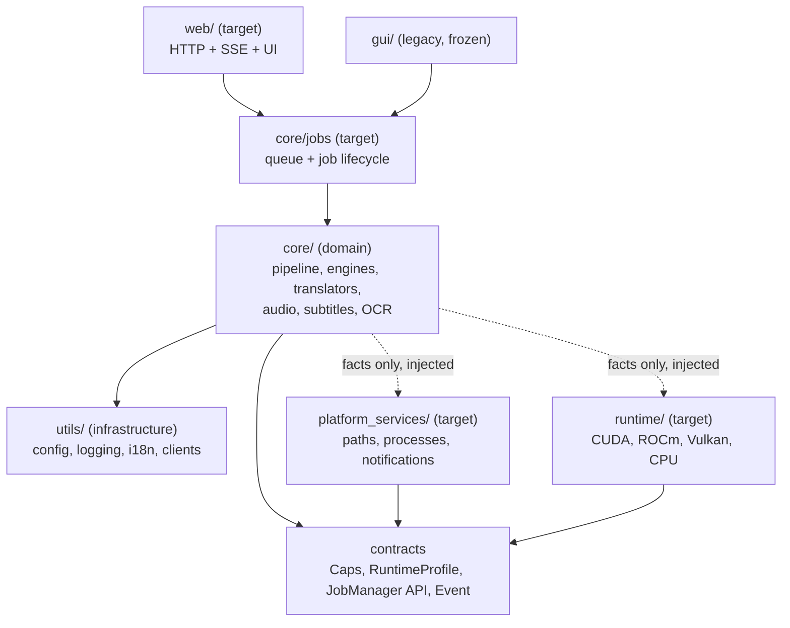

# Architecture

Status: baseline (2026-10-25). This directory describes the **target**
architecture and the migration still in progress. Where a module does not
exist yet, the document says so explicitly.

## Layers

Physical mapping (current and target):

| Layer | Path | Status |
|---|---|---|
| Domain (business logic) | `core/` | present |
| Job service | `core/jobs/` | present — shared by the headless queue; the Qt GUI still uses its own worker |
| Infrastructure | `utils/` | present |
| Platform services (OS) | `platform_services/` | **target** |
| Runtime (GPU backend) | `runtime/` | **target** |
| Web (API + UI) | `web/` | present (MVP) |
| GUI | `gui/` | present, **frozen** (replaced by the WebUI) |

## Dependency rules

| From | May import | Must not import |
|---|---|---|
| `core/` | `contracts`, `utils`, stdlib, third-party libraries | `platform_services`, `runtime`, `PyQt6`/`PySide6` |
| `platform_services/` | `contracts`, `utils`, stdlib | `core` |
| `runtime/` | `contracts`, `utils`, stdlib | `core` |
| `utils/` | stdlib, `contracts` | `core`, `platform_services`, `runtime` |
| `web/` | `core.jobs`, `contracts`, `utils` | `runtime`, `platform_services` internals, `PyQt6` |
| `gui/` (legacy) | `core.jobs`, `utils` | — (no new features) |

Known exception, recorded in the guard test allowlist: `core/queue_runner.py`
imports `gui.file_progress.FileProgress`, which is a pure-Python class with no
Qt dependency. It must be moved to `core/jobs/` as part of the service-layer
extraction.

## Invariants

1. No OS or GPU-backend checks inside `core/` (guard test:
   `linux_tests/test_architecture_boundaries.py`).
2. Only one GPU-heavy job at a time; the job service owns the queue.
3. Events on stdout are versioned and schema-checked
   (`linux_tests/test_events_schema.py`).
4. No secrets, credentials or personal data in the repository
   (`AGENTS.md`).
5. Drivers are never installed or modified by this project.

## Documents

- [layers.md](layers.md) — responsibilities and import rules per layer
- [contracts.md](contracts.md) — interfaces and data structures
- [runtime.md](runtime.md) — GPU backends and runtime policy
- [platform-services.md](platform-services.md) — OS-specific services
- [domain.md](domain.md) — pipeline and domain modules
- [events.md](events.md) — structured event protocol
- [config.md](config.md) — configuration and environment variables
- [security.md](security.md) — auth, paths, secrets, containers
- [testing.md](testing.md) — test strategy and CI matrix
- [extension-guide.md](extension-guide.md) — how to add engines, models, backends, pages
- [legacy/architecture_overview_v1.md](legacy/architecture_overview_v1.md) — obsolete v1.0 overview, kept for history

ADRs: [../adr/](../adr/) — support matrix: [../SUPPORT_MATRIX.md](../SUPPORT_MATRIX.md)
